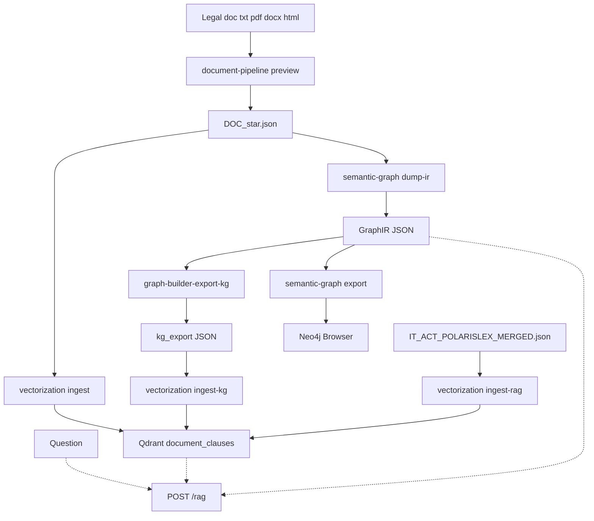
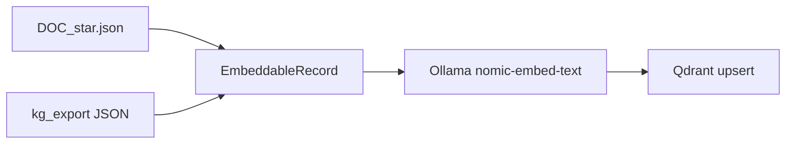
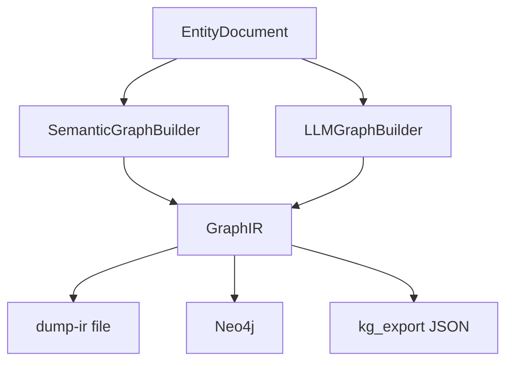
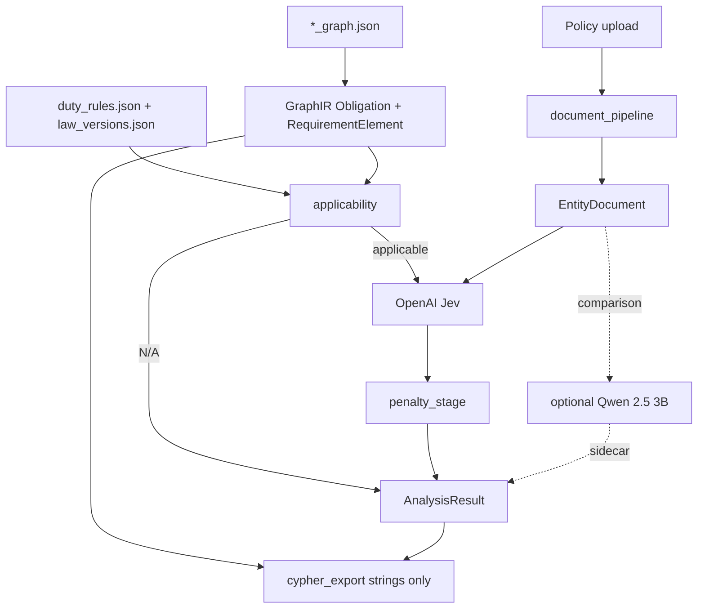

# PolarisLex architecture (current state)

PolarisLex is a legal-document intelligence stack. Today it **parses** documents, **embeds** clauses for search, **builds a graph** for structure, can **overlay** a private-company website privacy policy against an ideal topic graph from DPDP / SPDI / CERT-In / IT Act, can **analyze** that policy with GraphIR applicability plus OpenAI Jev classification and an optional local Qwen comparison, and can **write a client memo + PDF** from those findings (India MVP).

`/analyze` builds GraphIR in-process by default (Obligation + `RequirementElement` + `PENALIZES`). With `POLARIS_ANALYZE_GRAPH_SOURCE=neo4j`, it loads the exported catalog through Bolt/Cypher instead. OpenAI Jev owns duty statuses; optional fine-tuned Qwen 2.5 3B is a comparison column only. `/analyze` is **not** Q&A RAG — statute questions go to optional `POST /rag` (does not feed the memo).

Packages are independently installable. Vector search and Neo4j do **not** import each other. The product UI does **not** use Neo4j Browser. Law overlay reads the four `*_graph.json` files in `dataset/`; analyze uses those files by default and can switch to the exported Neo4j catalog. Duty metadata (roles, document types, elements, severity) lives in a sidecar: `compliance/src/compliance/data/duty_rules.json` and `law_versions.json`.

Interactive walkthrough: open the Cursor canvas beside chat (`polarislex-architecture.canvas.tsx`).

## What this is

| Layer | Package | What it does |
|---|---|---|
| Parse | `document_pipeline/` | File → structured `DOC_*.json` |
| Embed | `vectorization/` | JSON → Qdrant vectors + search |
| Graph IR | `graph_builder/` | GraphIR schema, LLM builder, kg_export dump, `catalog_to_graph_ir` |
| Graph CLI | `semantic_graph/` | Hierarchy builder, `dump-ir`, Neo4j export |
| Compare | `policy_compare/` | Ideal topic graph + overlay match; FastAPI `/compare`, `/analyze`, `/report`, optional `/rag` |
| Analyze | `compliance/` | Applicability, matching, classify, penalties, memo + PDF (India) |
| Q&A RAG | `rag/` | Dense vs GraphRAG statute Q&A (`POST /rag`); not used by `/analyze` |
| UI | `web/` + `docker/` | Upload policy, graphs + findings + report (`localhost:8080`) |

**Stores:** JSON files, Qdrant (`localhost:6333`), Neo4j (`localhost:7474` / Bolt `7687`). Embeddings: local Ollama (`localhost:11434`), default `nomic-embed-text`. Product API is FastAPI in Docker (`localhost:8000`). No SQLite, no Postgres.

## End-to-end (built)

A document is parsed once. Embedding and graph are optional downstreams. Product analyze uses the parsed `EntityDocument` plus in-process catalog GraphIR and sends each applicable duty plus policy clauses to Jev — it does not re-ingest the upload or use Qdrant for scoring. Optional `POST /rag` answers statute questions from `rag_section` (dense) or GraphIR + kg vectors (graph); it does not feed the memo.



## Document intelligence

```mermaid
flowchart LR
  loader --> cleaner --> sections[section_extractor]
  sections --> blocks[block_extractor]
  blocks --> builder[clause_builder]
  builder --> extractor[clause_extractor]
  extractor --> understand[document_understanding]
  understand --> context[context_builder]
  context --> entities[entity_extractor]
  entities --> preparer[DefaultLLMPreparer]
```

`document-pipeline preview <file>` calls `create_default_orchestrator()` and writes `document_pipeline/output/DOC_*.json`.



- Formats: `.txt`, `.pdf`, `.docx`, `.html` / `.htm`.
- Entities are dictionary/regex, not an LLM classifier.
- Preview JSON includes `clauses`, nested `contextual_clauses`, and `entity_clauses`.
- Heading regression: six synthetic policies in `document_pipeline/tests/fixtures/policies/`.

`DefaultLLMPreparer` produces `SemanticExtractionInput`. It does not call a chat model.

## Vector path

`vectorization` reads `DOC_*.json` (default `../document_pipeline/output`). It does not import `graph_builder` and does not open Neo4j.

**Embed text:** `section_title — clause_text`. For nomic, prefixes `search_document:` (ingest) and `search_query:` (search) are added at embed time only; they are not stored in Qdrant payload.

**Guards:** skip clauses under 5 tokens; split over 512 tokens at sentence boundaries with 50-token overlap. Original `clause_id` stays the citation; each chunk is its own point.

**Collection:** `document_clauses` (name is historical). Search filters `source_type` and the current embedding model. The CLI default drops hits below **0.55**. `/analyze` searches `kg_obligation` with a **0.30** floor (`PARTIAL_SCORE`) so partial hits are not discarded before classification.



### Point-id namespaces (same collection)

| `source_type` | Key |
|---|---|
| `document_clause` | `document_clause:{document_id}:{clause_id}:{chunk_index}` |
| `kg_obligation` | `kg_obligation:{law_code}:{obligation_id}:{chunk_index}` |
| `kg_section` | `kg_section:{law_code}:{section_id}:{chunk_index}` |
| `rag_section` | `rag_section:{law_code}:{doc_id}:{chunk_index}` |

Keys are hashed to a stable UUID so reruns overwrite instead of duplicating.

`vectorization ingest-kg` loads `*.json` from `VECTORIZATION_KG_DIR` (default `../kg_export`). KG paragraphs split at 300 tokens. Empty `text` is skipped. `reembed` runs KG ingest first, then document ingest.

`vectorization ingest-rag` loads `dataset/IT_ACT_POLARISLEX_MERGED.json` (`VECTORIZATION_RAG_PATH` or `--path`) as `source_type=rag_section`. Embed `retrieval_text` (fallback `clause_text`); cite `doc_id`. Do **not** ingest this file as `kg_obligation`.

## Graph path

Two builders, one IR (`nodes` + `relationships`).



### SemanticGraphBuilder (CLI today)

Used by `semantic-graph dump-ir` and `semantic-graph export`. Hierarchy + reference resolution. No LLM unless `dump-ir --enrich`.

Neo4j label map:

| GraphIR | Neo4j |
|---|---|
| `LawVersion` | `Document` |
| `Section` / `SubSection` | `Section` |
| `Obligation` | `Obligation` |
| `RequirementElement` | `RequirementElement` |
| `Penalty` | `Penalty` |
| `HAS_SECTION` / `HAS_CHAPTER` / `HAS_SUBSECTION` | `CONTAINS` |
| `HAS_CLAUSE` | `HAS_CLAUSE` |
| `HAS_OBLIGATION` | `HAS_OBLIGATION` |
| `HAS_REQUIREMENT` | `HAS_REQUIREMENT` |
| `PENALIZES` | `PENALIZES` |

Unnumbered headings become **sibling** Sections under Document. Nesting is parked, not a missing export.

India catalog duties enter GraphIR via `semantic-graph from-catalog` or in-process `catalog_to_graph_ir` (same `doc_id`s as `/analyze`). Requirement elements are lifted from `duty_rules.json` onto `HAS_REQUIREMENT`. `dump-ir --enrich` is a separate LLM slot extract; those ids are not catalog ids.

### LLMGraphBuilder

`GraphBuilderPipeline`: EntityDocument → LLM JSON → GraphIR → validator → Cypher → optional Neo4j. Still unused by dump-ir (which uses `SemanticEnrichmentStage` only when `--enrich`).

### File join (no Neo4j)

1. `semantic-graph from-catalog dataset/dpdp_graph.json … -o catalog-ir.json` (India duties)
2. `semantic-graph dump-ir statute.txt -o ir.json` (outline; add `--enrich` for slot Obligation nodes)
3. `graph-builder-export-kg ir.json -o ../kg_export/LAW.json --law-code LAW`
4. `vectorization ingest-kg`

`graph-builder-export-kg` keeps Section/Obligation text. Blank items are omitted.

## Compliance reasoning engine

Hosted by `policy_compare` FastAPI. Core loop is `compliance.analyze_document`. Jev decides the authoritative status; Qwen is optional and never changes the strip, gaps, or penalties.

Default profile for a website privacy policy: document type `privacy_policy`, roles `ENTITY_DATA_FIDUCIARY` + `ENTITY_BODY_CORPORATE`. Optional form fields: `analysis_date` (`YYYY-MM-DD`), `roles` (comma-separated).



1. **Catalog + sidecar.** 63 catalog obligation ids from the four law graphs. `duty_rules.json` adds roles, document types, requirement-element keywords, severity, generic-language tags. `law_versions.json` marks acts ACTIVE / PARTIALLY_COMMENCED / SUPERSEDED (SPDI is still scored).
2. **Applicability first.** `apply_duty` checks jurisdiction, roles, document type, and law version. N/A duties (CA / e-sign IT Act, Consent Manager, CERT-In operational_security, and so on) skip Qdrant, stay out of `gaps`, and are excluded from the coverage denominator.
3. **Classify.** Jev receives each applicable catalog duty and all parsed policy clauses and returns one fixed status: `covered | partial | missing | not_applicable | undetermined | conflict | violation`. Out-of-set answers become `undetermined`. Qwen receives the same input only when `POLARIS_QWEN_MODEL` is configured; its answer is stored beside Jev and never drives scoring. Report arithmetic: applicable mix equals `total`; `total + not_applicable` equals catalog size (63 for India).
5. **Penalties.** After status. `potential_exposure` vs `may_trigger`. Never attached to covered or N/A. Copy states this is not a determination of liability.
6. **Cypher.** `compliance.cypher_export` emits MATCHED_BY / HAS_REQUIREMENT / SUPPORTED_BY / CONFLICTS_WITH / MAY_TRIGGER **strings** for export. When `POLARIS_ANALYZE_GRAPH_SOURCE=neo4j`, `/analyze` separately reads the exported catalog through parameterized Bolt queries.

Frozen pytest gold: `compliance/tests/benchmark/`. Jev-backed live analysis requires `OPENAI_API_KEY`; Qwen comparison additionally requires a trained Ollama model configured as `POLARIS_QWEN_MODEL`.

## CLI cheat sheet

```bash
# Parse
document-pipeline preview path/to/policy.txt

# Vectors (from vectorization/)
docker compose up -d qdrant
vectorization
vectorization search "personal data" --top-k 5
vectorization ingest-kg
vectorization ingest-rag --path ../dataset/IT_ACT_POLARISLEX_MERGED.json
vectorization search "access personal data" --source-type kg_obligation --top-k 5
vectorization search "withdraw consent" --source-type rag_section --top-k 5
vectorization reembed

# Graph without Neo4j
semantic-graph dump-ir statute.txt -o ir.json
semantic-graph dump-ir --enrich statute.txt -o ir.json
semantic-graph from-catalog dataset/dpdp_graph.json dataset/spdi_graph.json dataset/certin_graph.json dataset/itact_graph.json -o catalog-ir.json
graph-builder-export-kg ir.json -o ../kg_export/LAW.json --law-code LAW

# Graph into Neo4j
docker compose up -d neo4j
semantic-graph export statute.txt
semantic-graph from-catalog dataset/dpdp_graph.json -o catalog-ir.json --to-neo4j
semantic-graph export statute.txt --ir-output ir.json

# Product UI (graphs + engine analysis + memo)
docker compose up --build web api
# Qdrant (compose) + Ollama on the host (law embeddings for ingestion and /rag)
# open http://localhost:8080
```

Qdrant dashboard: `http://localhost:6333/dashboard`. Neo4j Browser: `http://localhost:7474` (credentials are in root `docker-compose.yml`, not repeated here).

## Product UI (Docker)

```bash
docker compose up --build web api
# UI: http://localhost:8080   API: http://localhost:8000/health
```

`--build` after engine or UI changes, then **Run Validation** again. A previous in-browser result (for example 21/63) is stale until you re-run against a rebuilt `api`.

`POST /compare` (multipart file) runs `document_pipeline`, projects the four law JSON files into topic hubs, and returns two view graphs plus match links. Matching is **lexical topic keywords**. It only groups User Graph folders (Consent vs Extra). It is **not** the coverage score and does **not** paint node colors after analyze. Compare does not need Qdrant or Ollama.

`POST /analyze` (same upload, optional form `jurisdiction` default `IN`, `analysis_date`, `roles`) builds GraphIR from the four law JSON files by default, or reads the exported catalog through Neo4j when `POLARIS_ANALYZE_GRAPH_SOURCE=neo4j`. Obligation node ids are the authoritative duty set. Jev receives each applicable duty and all policy clauses; its fixed answer is `AnalysisResult.obligations[].status`. Optional Qwen status is stored beside it and never changes gaps, penalties, or coverage. N/A is excluded. Penalties come from GraphIR `PENALIZES` after status. Response is `AnalysisResult`. The uploaded policy is not sent to Qdrant by default; set `POLARIS_INGEST_ON_ANALYZE=true` to embed and upsert its clauses during analysis. If OpenAI Jev, the selected graph source, or opt-in vector ingest is unavailable, `/analyze` returns **503**; `/compare` still works. Analyze is **not** statute Q&A.

`POST /rag` `{question, mode: dense|graph}` is statute Q&A. The web **Queries** tab posts to `/api/rag` (no policy upload). Dense retrieves `rag_section` from the merged statute JSON. Graph seeds `kg_obligation` (fallback `kg_section`) and expands one hop on in-process GraphIR (`PENALIZES`, same `section_id` / act). Local Qwen answers only from those excerpts. 503 if Qdrant or Ollama is down. The memo does not use this endpoint.

`POST /chat-with-pdf` accepts `file` and `question`, embeds the uploaded policy, filters retrieval to that document's `document_clause` points, and answers with local Qwen from those clauses only. It is separate from statute Q&A and `/analyze`.

Uploads persist the document-pipeline preview as `DOC_*.json` under `POLARIS_DOCUMENT_DIR` (default `document_pipeline/output`). `GET /documents/{document_id}` reads that JSON artifact; there is no app database.

The UI is landing (load a policy) then a graph-first workspace. Untitled `S001` is labeled **Introduction**. Clauses stay in node summaries (click), not as a 246-node star. Coverage strip, graph colors, and Findings follow `AnalysisResult` (applicable % , weighted %, covered / partial / missing / N/A / gaps). After analyze, `POST /report` assembles every duty into a client memo. Per-law Themes (2–3 missing/partial titles) and the first summary sentence (applicable-only scoreboard; missing ≠ violation) are engine-owned; Qwen may append extra briefing sentences. The Findings page shows **View Report** once that JSON is ready; the memo itself is a separate screen (`#report`). `POST /report.pdf` renders that JSON with ReportLab (upload filename, priority-gaps block, liability disclaimer); download does not call the chat model again. If chat is down, the scoreboard, duty table, and PDF still work (`narrative_available: false`).

## Not in this build

- Neo4j / Cypher **execution** at analyze time is opt-in (`POLARIS_ANALYZE_GRAPH_SOURCE=neo4j`); in-process GraphIR remains the default
- GraphIR `applies_if` properties (runtime N/A is the sidecar + `applicability.py`, not a Cypher precondition on Obligation nodes)
- Durable reports database (optional `POLARIS_REPORT_DIR` JSON only; no SQLite)
- LLM `retrieval_text` rewrite (Spec 4, parked)
- Overlay embeddings / LLM labels for User Graph folders — parked; keywords stay clustering-only
- Additional jurisdiction catalogs are configured through `POLARIS_JURISDICTIONS_JSON`; India remains the built-in default
- Cloud chat (default local Ollama Qwen)
- The UI does not yet expose the separate `/chat-with-pdf` endpoint

## Decisions worth stating

- **Privacy:** local Ollama embeddings by default; other embedders are a settings swap. Memo chat is local Qwen; compact report JSON still leaves the machine if a cloud `ChatFn` is wired later. `POST /rag` uses the same local Qwen path and does not accept a policy upload.
- **RAG corpora:** dense Q&A is `dataset/IT_ACT_POLARISLEX_MERGED.json` as `rag_section`. GraphRAG is catalog GraphIR + `kg_obligation` / `kg_section`. The merged file is never ingested as `kg_obligation`.
- **Stores:** JSON parsed artifacts, Qdrant vectors, Neo4j graph. JSON files are the parsed store (SQLite will not be added).
- **Naming:** structural `ContextBuilder` is document structure only. Engine output is `AnalysisResult`.
- **Isolation:** `vectorization` never imports `graph_builder` and never opens a Neo4j driver.
- **Classification:** statuses and coverage come from the engine, not Qwen. Missing ≠ legal violation.
