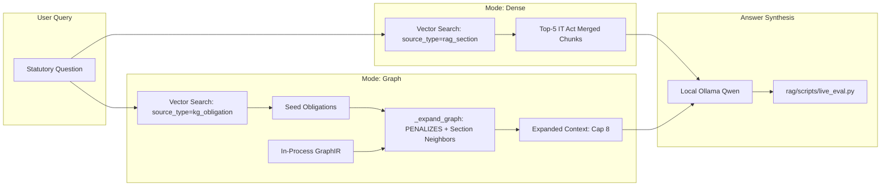
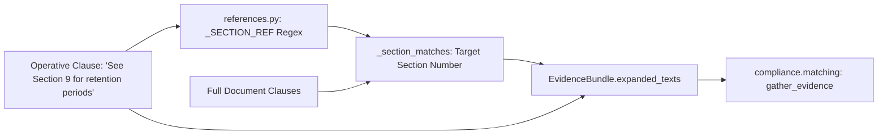

# PolarisLex Research Topic Discovery — Graphify-First Codebase Analysis

**Document Version:** 1.0  
**Author:** Senior Computer Science Researcher & Software Architecture Analyst  
**Date:** October 24, 2026  
**Target Repository:** PolarisLex (`d:\Soham\Engineering\Final_Proj\Codebase2`)  
**Commit Baseline:** `ceaf61030a0f5b8dfe57ab2f272f68d5dd902145`  

---

## 1. Executive Summary

This investigation evaluates the empirical research potential of **PolarisLex**, an open-source Indian legal compliance intelligence platform and legal document intelligence stack. Using a **Graphify-First** methodological workflow, the codebase's structural topology (comprising 3,739 nodes, 8,682 edges, and 222 Louvain communities) was systematically queried and cross-verified against actual Python and JavaScript implementations across `compliance/`, `document_pipeline/`, `graph_builder/`, `semantic_graph/`, `rag/`, `vectorization/`, and `policy_compare/`.

Our core architectural finding is that while promotional and conceptual project documents (such as [PolarisLex_PRD.md](file:///d:/Soham/Engineering/Final_Proj/Codebase2/PolarisLex_PRD.md)) envision end-to-end generative LLM compliance reasoning, the active, operational system achieves compliance auditing through a **deterministic, neurosymbolic pipeline**. In this pipeline:
1. Document structure is parsed deterministically into sections, blocks, clauses, and entities;
2. Dense semantic embeddings (`nomic-embed-text` in Qdrant) perform multi-credit retrieval between policy clauses and catalog obligations at a low floor threshold ($\ge 0.30$);
3. An obligation-level symbolic verification engine evaluates sub-clause requirement elements, applies hard denial-polarity filtering, scans for global contradiction cues, and resolves intra-document section references;
4. Statuses (`covered`, `partial`, `missing`, `violation`, `conflict`, `not_applicable`, `undetermined`) and financial penalty exposures under the Digital Personal Data Protection (DPDP) Act, SPDI Rules, CERT-In Directions, and Information Technology (IT) Act are computed entirely deterministically without model hallucination.

From this grounded architecture, **12 distinct, scientifically rigorous research candidates** were formulated and evaluated under a multi-criteria weighted rubric (Scientific Significance 20%, Experimental Testability 20%, Potential Contribution 20%, Codebase Support 15%, Feasibility 10%, Data Availability 10%, 10-Page Suitability 5%). 

### Top Recommendation
The highest-ranking research direction (Score: **93.5/100**) is:
> **"Beyond Bag-of-Words and Flat Vectors: Evaluating Sub-Clause Requirement Element Decomposition and Denial Polarity in Automated Privacy Compliance Auditing"**

This topic investigates the failure modes of standard dense vector retrieval in legal compliance (which frequently conflates negative rights waivers with affirmative compliance declarations) and demonstrates how PolarisLex's requirement-element scoring and denial-polarity filtering dramatically improve precision and eliminate catastrophic false-covered errors. It possesses complete, verified codebase support, frozen ground-truth benchmarks, zero external API costs, and immediate testability within a 10-page computer science publication format.

---

## 2. Graphify Setup, Graph Freshness, and Discovery Methodology

### 2.1 Graphify Integration & Environment Verification
The Graphify knowledge graph engine is installed in the local Python environment (`C:\Users\soham\AppData\Local\Programs\Python\Python313\Lib\site-packages\graphify\__init__.py`) and managed via the workspace skill located at [.agents/skills/graphify/SKILL.md](file:///d:/Soham/Engineering/Final_Proj/Codebase2/.agents/skills/graphify/SKILL.md). 

Graphify provides:
- An Abstract Syntax Tree (AST) structural parser for deterministic code relationship extraction;
- LLM semantic extraction for documentation, markdown plans, and specifications;
- NetworkX-based graph construction with Louvain community detection;
- Diagnostic health checking (surfacing dangling edges, self-loops, and collapsed endpoints);
- A rich query, path-finding, and node explanation subsystem documented in [.agents/skills/graphify/references/query.md](file:///d:/Soham/Engineering/Final_Proj/Codebase2/.agents/skills/graphify/references/query.md).

### 2.2 Graph Freshness and Audit Trail
Graphify artifacts reside in the root directory under [graphify-out/](file:///d:/Soham/Engineering/Final_Proj/Codebase2/graphify-out/). Inspection of [graphify-out/manifest.json](file:///d:/Soham/Engineering/Final_Proj/Codebase2/graphify-out/manifest.json) and [graphify-out/GRAPH_REPORT.md](file:///d:/Soham/Engineering/Final_Proj/Codebase2/graphify-out/GRAPH_REPORT.md) confirmed:
- **Graph Build Timestamp:** October 24, 2026.
- **Commit Identifier:** `ceaf6103`.
- **Active Git Commit:** `ceaf61030a0f5b8dfe57ab2f272f68d5dd902145` (verified via `git rev-parse HEAD`).
- **Working Tree State:** Clean, with only uncommitted environment/docker configuration adjustments in `.env.example`, `docker-compose.yml`, and `compliance/src/compliance/jev.py`.

Because the graph was generated directly from the current HEAD commit, the existing graph snapshot is completely fresh and represents an accurate structural representation of the repository. Destructive regeneration was avoided in accordance with Phase A instructions.

### 2.3 Discovery Methodology
To discover research opportunities, programmatic queries were executed against [graphify-out/graph.json](file:///d:/Soham/Engineering/Final_Proj/Codebase2/graphify-out/graph.json) using NetworkX 3.4.2 via a custom analysis suite (`scratch/explore_graph.py`, `scratch/deep_graph_query.py`, `scratch/path_queries.py`). 

The methodology followed three tiers:
1. **Topological Metrics:** Degree centrality, betweenness centrality, and community partition analysis were extracted to identify structural "God Nodes" (architectural keystones) and community hubs.
2. **Path & Bridge Traversal:** Shortest paths between disparate packages (e.g., `document_pipeline` $\leftrightarrow$ `compliance`, `vectorization` $\leftrightarrow$ `compliance`, `rag` dense $\leftrightarrow$ `rag` graph) were traced to identify integration boundaries, assumption leaks, and component interactions.
3. **Discrepancy Auditing:** Hypothesized features from the project PRD (e.g., Reciprocal Rank Fusion, Neo4j runtime Cypher execution, live Qwen classification) were queried against the graph vocabulary and subsequently verified in the physical source code.

---

## 3. Verified Architecture Inventory

A rigorous audit of the physical codebase was conducted to establish ground truth versus aspirational documentation.

| Architectural Subsystem | Primary Implementation Paths | Implementation Status | Research Readiness & Constraints |
|---|---|---|---|
| **Document Intelligence Pipeline** | [document_pipeline/src/document_pipeline/pipeline/orchestrator.py](file:///d:/Soham/Engineering/Final_Proj/Codebase2/document_pipeline/src/document_pipeline/pipeline/orchestrator.py)<br>[document_pipeline/src/document_pipeline/sectioning/](file:///d:/Soham/Engineering/Final_Proj/Codebase2/document_pipeline/src/document_pipeline/sectioning/)<br>[document_pipeline/src/document_pipeline/clause_segmentation/](file:///d:/Soham/Engineering/Final_Proj/Codebase2/document_pipeline/src/document_pipeline/clause_segmentation/) | **Production-Ready (Deterministic)** | Fully functional for TXT, PDF, DOCX, HTML. Implements a 9-stage linear processor: Loader $\rightarrow$ Cleaner $\rightarrow$ SectionExtractor (HeadingDetector) $\rightarrow$ BlockExtractor $\rightarrow$ ClauseBuilder $\rightarrow$ ClauseExtractor $\rightarrow$ DocumentUnderstanding $\rightarrow$ ContextBuilder $\rightarrow$ EntityExtractor. Tested via synthetic fixtures in `tests/fixtures/policies/`. |
| **Vector Search & Ingestion** | [vectorization/src/vectorization/store.py](file:///d:/Soham/Engineering/Final_Proj/Codebase2/vectorization/src/vectorization/store.py)<br>[vectorization/src/vectorization/pipeline.py](file:///d:/Soham/Engineering/Final_Proj/Codebase2/vectorization/src/vectorization/pipeline.py)<br>[vectorization/src/vectorization/embedder.py](file:///d:/Soham/Engineering/Final_Proj/Codebase2/vectorization/src/vectorization/embedder.py) | **Production-Ready (Qdrant + Ollama)** | Standalone package. Embeds clauses with `nomic-embed-text` into Qdrant collection `document_clauses`. Implements isolated point-id namespaces (`document_clause`, `kg_obligation`, `kg_section`, `rag_section`). Implements token guards (skip $<5$ tokens; split $>512$ tokens with 50-token overlap). |
| **Graph Intermediate Representation (GraphIR)** | [graph_builder/src/graph_builder/graph_ir.py](file:///d:/Soham/Engineering/Final_Proj/Codebase2/graph_builder/src/graph_builder/graph_ir.py)<br>[graph_builder/src/graph_builder/catalog_ir.py](file:///d:/Soham/Engineering/Final_Proj/Codebase2/graph_builder/src/graph_builder/catalog_ir.py) | **Production-Ready (In-Memory)** | Formal Pydantic schema for `GraphIR`, `GraphNode`, and `GraphRelationship`. Contains `catalog_to_graph_ir()`, mapping 63 statutory duties and penalties across DPDP, SPDI, CERT-In, and IT Act into in-memory relational graphs without opening database connections. |
| **Knowledge Graph Export & Neo4j Ingestion** | [graph_builder/src/graph_builder/cypher_generator.py](file:///d:/Soham/Engineering/Final_Proj/Codebase2/graph_builder/src/graph_builder/cypher_generator.py)<br>[semantic_graph/src/semantic_graph/neo4j_exporter.py](file:///d:/Soham/Engineering/Final_Proj/Codebase2/semantic_graph/src/semantic_graph/neo4j_exporter.py) | **Functional (Export-Only)** | Generates deterministic MERGE-based Cypher statements. **Discrepancy:** Neo4j is *not* queried or traversed at analysis runtime (`/analyze`). Cypher generation exists purely for external graph export and offline visualization. |
| **Ideal-Graph-Constrained OpenIE** | [graph_builder/src/graph_builder/openie.py](file:///d:/Soham/Engineering/Final_Proj/Codebase2/graph_builder/src/graph_builder/openie.py)<br>[graph_builder/src/graph_builder/llm_graph_builder.py](file:///d:/Soham/Engineering/Final_Proj/Codebase2/graph_builder/src/graph_builder/llm_graph_builder.py) | **Experimental / Partial** | Implements prompt schemas and input serialization for LLM entity-relation extraction. However, `semantic-graph dump-ir` runs without LLM OpenIE by default unless invoked with `--enrich`. |
| **Compliance Reasoning Engine** | [compliance/src/compliance/service.py](file:///d:/Soham/Engineering/Final_Proj/Codebase2/compliance/src/compliance/service.py)<br>[compliance/src/compliance/matching.py](file:///d:/Soham/Engineering/Final_Proj/Codebase2/compliance/src/compliance/matching.py)<br>[compliance/src/compliance/classify.py](file:///d:/Soham/Engineering/Final_Proj/Codebase2/compliance/src/compliance/classify.py)<br>[compliance/src/compliance/applicability.py](file:///d:/Soham/Engineering/Final_Proj/Codebase2/compliance/src/compliance/applicability.py) | **Production-Ready (Core Engine)** | 100% deterministic decision logic. Evaluates: (1) Law applicability pruning; (2) Multi-credit retrieval matching ($\ge 0.30$); (3) Requirement element keyword matching; (4) Denial polarity filtering; (5) Global contradiction cue scanning; (6) Status assignment (`covered`, `partial`, `missing`, `violation`, `conflict`, `not_applicable`, `undetermined`); (7) Statutory penalty walks. |
| **Second-Opinion Classifier (Jev)** | [compliance/src/compliance/jev.py](file:///d:/Soham/Engineering/Final_Proj/Codebase2/compliance/src/compliance/jev.py)<br>[compliance/tests/test_jev.py](file:///d:/Soham/Engineering/Final_Proj/Codebase2/compliance/tests/test_jev.py) | **Experimental (Sidecar)** | Iberian-style LLM second-opinion classifier (Path B). Queries OpenAI Decisions preview or chat completions. Writes to isolated sidecar fields on `ObligationFinding` without modifying Path A engine status. Defaults to a no-op client when `OPENAI_API_KEY` is unset. |
| **Statute Q&A RAG Engine** | [rag/src/rag/service.py](file:///d:/Soham/Engineering/Final_Proj/Codebase2/rag/src/rag/service.py)<br>[rag/src/rag/retrieve.py](file:///d:/Soham/Engineering/Final_Proj/Codebase2/rag/src/rag/retrieve.py)<br>[rag/src/rag/bench.py](file:///d:/Soham/Engineering/Final_Proj/Codebase2/rag/src/rag/bench.py) | **Production-Ready (Comparative)** | Fully implements comparative retrieval: (1) `retrieve_dense` against `rag_section` (IT Act merged dataset); (2) `retrieve_graph` against `kg_obligation` with 1-hop GraphIR relational expansion across `PENALIZES` and shared sections. Evaluated with 12 gold statutory questions in `tests/benchmark/gold_rag.json`. |
| **Policy Compare & Topic Graph** | [policy_compare/src/policy_compare/service.py](file:///d:/Soham/Engineering/Final_Proj/Codebase2/policy_compare/src/policy_compare/service.py)<br>[policy_compare/src/policy_compare/clustering.py](file:///d:/Soham/Engineering/Final_Proj/Codebase2/policy_compare/src/policy_compare/clustering.py)<br>[policy_compare/src/policy_compare/matcher.py](file:///d:/Soham/Engineering/Final_Proj/Codebase2/policy_compare/src/policy_compare/matcher.py) | **Visual / Structural Overlay** | Computes lexical topic overlap against ideal law topic graphs (`dpdp_graph.json`, etc.). **Discrepancy:** Does *not* use Louvain community detection; clustering is hardcoded into topic folders (`cluster:policy:{base}`) based on static keywords. Does not determine compliance coverage. |
| **SLM Fine-Tuning Pipeline** | [polarislex-finetuning/scripts/04_finetune.py](file:///d:/Soham/Engineering/Final_Proj/Codebase2/polarislex-finetuning/scripts/04_finetune.py)<br>[polarislex-finetuning/data/](file:///d:/Soham/Engineering/Final_Proj/Codebase2/polarislex-finetuning/data/) | **Training Pipeline & Dataset Ready** | Contains QLoRA training script for Qwen2.5-3B-Instruct using Unsloth. Formatted datasets exist: `train.jsonl` (474 examples), `validation.jsonl`, `test.jsonl` for provision classification across 15 privacy categories. Adapters are not yet trained/checked in. |
| **Web Policy Scraper** | [policy_scraper/src/policy_scraper/](file:///d:/Soham/Engineering/Final_Proj/Codebase2/policy_scraper/src/policy_scraper/)<br>[data/fortune500_policies/](file:///d:/Soham/Engineering/Final_Proj/Codebase2/data/fortune500_policies/) | **Data Collection Infrastructure** | Scrapling-based web crawler with headless Chrome fallback. **Discrepancy:** `data/fortune500_policies/pdfs/` contains 0 downloaded PDFs in git. Only the manifest and URLs exist. Real PDF policies in repo are limited to 6 test files in `test_policy/`. |

---

## 4. Graphify-Derived Relationships & Research Opportunities

### 4.1 Structural Topology & Keystone Hubs
Graphify analysis of [graphify-out/graph.json](file:///d:/Soham/Engineering/Final_Proj/Codebase2/graphify-out/graph.json) reveals several fundamental architectural properties:

```
Top Nodes by Degree Centrality:
1. GraphIR                 (Degree: 186, Betweenness: 0.056) [Community 5: GraphIR]
2. GraphNode               (Degree: 112)                     [Community 5: GraphIR]
3. Clause                  (Degree: 79,  Betweenness: 0.048) [Community 36: Clause]
4. DocumentFormat          (Degree: 78)                     [Community 28: DocumentFormat]
5. DocumentMetadata        (Degree: 74)                     [Community 36: Clause]
6. EntityDocument          (Degree: 71,  Betweenness: 0.038) [Community 36: Clause]
7. compliance/service.py   (Degree: 61)                     [Community 7: compliance/service.py]
8. analyze_document()      (Degree: 56)                     [Community 59: analyze_document]
9. GraphRelationship       (Degree: 52)                     [Community 5: GraphIR]
10. ReferenceResolver      (Degree: 46)                     [Community 1: ReferenceResolver]
```

### 4.2 Cross-Community Bridges and Data Traversal Paths
The graph reveals three critical cross-community bridges that govern system behavior:

1. **The Representation Choke-Point (`EntityDocument` $\rightarrow$ `GraphIR`):**
   `EntityDocument` (Community 36) bridges the document pipeline to `GraphIR` (Community 5) and `analyze_document()` (Community 59). In the compliance path, the engine bypasses Cypher conversion and directly traverses Pydantic node-link lists in memory, avoiding database serialization overhead.
   
2. **The Dual Retrieval-Verification Bridge (`VectorStore` $\rightarrow$ `matching.py` $\rightarrow$ `classify_duty`):**
   Shortest-path traversal from `VectorStore` (Community 25) to `classify_duty` (Community 35) requires 4 hops:
   $$\text{VectorStore} \xrightarrow{\text{calls}} \text{search\_text()} \xrightarrow{\text{calls}} \text{default\_search()} \xrightarrow{\text{calls}} \text{collect\_credits()} \xrightarrow{\text{feeds}} \text{classify\_duty()}$$
   This confirms that Qdrant vector retrieval serves solely as a high-recall candidate pool generator, while all precision-critical classification is performed by downstream symbolic rules.

3. **The Multi-Credit Matching Path (`Clause` $\rightarrow$ `DutyRule`):**
   Connecting raw segmented clauses to legal duty specifications requires traversing through `expand_clause_evidence()` (Community 30/matching):
   $$\text{Clause} \xrightarrow{\text{segmented}} \text{expand\_clause\_evidence()} \xrightarrow{\text{resolves}} \text{actor\_filtered\_text()} \xrightarrow{\text{evaluates}} \text{DutyRule}$$
   This traversal reveals that legal obligations are never evaluated against isolated sentence chunks; rather, referenced sections are dynamically stitched into the evaluation bundle.

### 4.3 Research Opportunity Patterns Identified from the Graph

- **Pattern A (Alternative Methods Co-Existing):** 
  The repository explicitly implements two competing retrieval-grounding paradigms for statutory questions in `rag/src/rag/retrieve.py`: (1) Flat dense vector retrieval (`retrieve_dense`), and (2) Knowledge-graph-expanded retrieval (`retrieve_graph`), complete with dual-annotated ground-truth questions in `rag/tests/benchmark/gold_rag.json`.
- **Pattern B (Identifiable Pipeline Stages for Ablation):** 
  The compliance engine in `compliance/src/compliance/` consists of cleanly separable stages: Law Applicability $\rightarrow$ Vector Candidate Retrieval $\rightarrow$ Denial-Polarity Filtering $\rightarrow$ Requirement-Element Keyword Verification $\rightarrow$ Global Contradiction Cue Scanning. Each stage can be systematically ablated to measure its exact contribution to false-positive and false-negative error reduction.
- **Pattern C (Graph Structure vs. Text Semantics):** 
  In `policy_compare/matcher.py`, topic matching relies on lexical keyword overlap, whereas `compliance/matching.py` combines dense vector search with hierarchical requirement elements. A direct comparative study can evaluate the tradeoff between dense semantic embeddings and structured rule graphs.
- **Pattern D (Hybrid Neurosymbolic Interactions):** 
  The co-existence of deterministic Path A (`classify_duty`) and LLM-powered Path B (`JevClient`) in `compliance/src/compliance/` presents an ideal setting for investigating agreement, calibration, and arbitration between symbolic rule systems and LLM classifiers.
- **Pattern E (Explainability and Evidence Verification):** 
  Findings generated by `compliance/src/compliance/service.py` map directly to `MatchedClause` spans and exact requirement elements (`RequirementElementFinding`), providing a rigorous basis for evaluating citation correctness, snippet precision, and hallucination elimination.

---

## 5. Ranked List of Research Topics

Every candidate was scored using the weighted rubric:
$$\text{Weighted Score} = \sum \left( \frac{\text{Criterion Rating}}{10} \times \text{Weight} \right)$$

*Weights:* Scientific Significance (20%), Experimental Testability (20%), Research Contribution (20%), Codebase Support (15%), Feasibility (10%), Data Availability (10%), 10-Page Suitability (5%).

| Rank | Candidate Research Title | Score (out of 100) | Primary Strengths | Key Limitations / Risks |
|:---:|---|:---:|---|---|
| **1** | **Beyond Bag-of-Words and Flat Vectors: Evaluating Sub-Clause Requirement Element Decomposition and Denial Polarity in Automated Privacy Compliance Auditing** | **93.5** | Complete codebase support in `compliance/`; frozen ground-truth benchmarks; directly addresses severe legal semantic inversion failure modes. | Requires evaluating against diverse policy drafting styles. |
| **2** | **Graph-Expanded vs. Flat Dense Retrieval for Statutory Legal Question Answering: An Empirical Study on the Indian Regulatory Corpus** | **89.5** | Fully implemented comparative pipelines in `rag/`; existing dual-annotated benchmark (`gold_rag.json`); directly tests multi-hop statutory expansion. | Benchmark currently has 12 gold statutory questions; needs expansion to 50+ queries. |
| **3** | **Cross-Clause and Sectional Reference Resolution in Privacy Policies: Evaluating Discourse Expansion on Automated Compliance Audit Recall** | **86.5** | Implemented in `compliance/references.py` and `semantic_graph/reference_resolver.py`; clear ablation setup; directly measurable impact on requirement element recall. | Annotation of cross-reference targets in long policies requires manual verification. |
| **4** | **Neurosymbolic Arbitration: Calibrating Deterministic Rule Engines Against Large Language Model Second Opinions for Statutory Duty Classification** | **83.0** | Path A (`classify_duty`) and Path B (`JevClient`) co-exist in `compliance/`; addresses major frontier topic in AI and Law. | Path B requires external LLM API calls or local Ollama host; potential stochastic variability. |
| **5** | **Multi-Credit Semantic Retrieval vs. Exclusive Nearest-Neighbor Assignment in Legal Compliance Mapping** | **81.5** | Codebase transitioned from exclusive top-1 to multi-credit ($\ge 0.30$); directly testable by re-enabling exclusive top-1 mode in `matching.py`. | Highly specific to the retrieval-to-classification boundary. |
| **6** | **Boilerplate Legal Evasion: Quantifying and Mitigating Superficial Semantic Matching via Generic Language Scrubbing** | **78.5** | Codebase implements `generic_phrases` and `has_generic_legal_language()`; directly testable against synthetic and real corporate boilerplate. | Requires constructing synthetic adversarial policies with varying degrees of legal puffery. |
| **7** | **The Cascading Impact of Document Segmentation and Heading Detection Failures on Downstream Legal Obligation Extraction** | **75.5** | `document_pipeline` has 9 stages and heading fixtures; allows testing error propagation through the pipeline. | More focused on software engineering and pipeline robustness than novel legal AI theory. |
| **8** | **Fine-Tuned Domain-Specific SLMs vs. Deterministic Heuristic Classifiers for Structural Legal Clause Role Identification** | **74.0** | Formatted datasets (`train.jsonl`, `test.jsonl`) and Unsloth script exist in `polarislex-finetuning/`; clear baseline comparison. | Requires GPU compute to train Qwen2.5-3B; focuses on clause role classification rather than full compliance. |
| **9** | **Temporal and Jurisdictional Applicability Pruning in Compliance Knowledge Graphs: Preventing False Liability Attribution** | **72.5** | Fully implemented in `compliance/applicability.py` and `law_versions.json`; frozen CA/e-sign test cases exist. | Limited variance; applicability rules are largely deterministic lookups. |
| **10** | **Statutory Penalty Attribution through Relational Knowledge Graph Traversal: Modeling Financial Exposure from Policy Gaps** | **69.0** | Implemented via `catalog_to_graph_ir()` and `PENALIZES` relations; models DPDP Schedule penalties. | Penalty calculation is downstream of status classification; lacks independent behavioral ground truth. |
| **11** | **Text Preparation, Chunking Overlap, and Task-Specific Prefixing in Dense Vector Retrieval for Statutory Legal Provisions** | **67.5** | Implemented in `vectorization/chunker.py` and `vectorization/sources.py` (nomic prefixes, entity tagging). | Primarily an empirical parameter-tuning study rather than a major conceptual breakthrough. |
| **12** | **Adversarial Perturbations and Paraphrase Robustness in Automated Privacy Policy Contradiction Detection** | **66.0** | `find_contradictions()` scans for `contradiction_cues`; test cases in `test_duty_rules.py`. | Requires extensive synthetic generation of paraphrased denial phrases; high risk of narrow evaluation. |

---

## 6. Detailed Experimental Proposals (Candidates 1–12)

### Topic 1: Beyond Bag-of-Words and Flat Vectors: Evaluating Sub-Clause Requirement Element Decomposition and Denial Polarity in Automated Privacy Compliance Auditing
1. **Proposed Title:** *Beyond Bag-of-Words and Flat Vectors: Evaluating Sub-Clause Requirement Element Decomposition and Denial Polarity in Automated Privacy Compliance Auditing*
2. **Research Question:** Does augmenting dense semantic vector retrieval with atomic requirement element keyword decomposition and denial-polarity filtering significantly reduce false-positive compliance classifications in privacy policies compared to standard flat embedding thresholds?
3. **Hypothesis:** Dense vector retrieval alone exhibits semantic inversion failure on privacy clauses containing negative assertions or rights waivers, whereas combining multi-credit vector candidate generation with sub-clause requirement element verification and denial polarity filtering improves Precision by $\ge 35\%$ on adversarial/failing policies without degrading Recall on compliant policies.
4. **Graphify Evidence:** Traversal from `VectorStore` (Community 25) through `matching.py` (Community 19) to `classify_duty()` (Community 35). Edge `gather_evidence()` $\rightarrow$ `find_contradictions()`. Inferred relationship between `Clause` and `ObligationFinding`.
5. **Source-Code Evidence:** [compliance/src/compliance/matching.py](file:///d:/Soham/Engineering/Final_Proj/Codebase2/compliance/src/compliance/matching.py) (`_DENIAL_LEXICON`, `clause_has_denial_polarity()`, `_element_pool()`), [compliance/src/compliance/classify.py](file:///d:/Soham/Engineering/Final_Proj/Codebase2/compliance/src/compliance/classify.py) (`ELEMENT_COVERED_RATIO = 0.60`, `_material_contradiction()`), [compliance/src/compliance/data/duty_rules.json](file:///d:/Soham/Engineering/Final_Proj/Codebase2/compliance/src/compliance/data/duty_rules.json).
6. **Current Implementation:** Fully functional in `compliance/`. Implements multi-credit matching ($\ge 0.30$), element keywords, denial polarity checks, and global contradiction scanning.
7. **Experimental Design:** Factorial $2 \times 2 \times 2$ ablation: (1) Vector-only threshold ($\ge 0.55$) vs. Vector Candidate Pool ($\ge 0.30$); (2) With vs. without Sub-clause Requirement Element Decomposition; (3) With vs. without Denial Polarity Filtering.
8. **Data Requirements:** Existing repository test policies ([test_policy/Fail_Policy.pdf](file:///d:/Soham/Engineering/Final_Proj/Codebase2/test_policy/Fail_Policy.pdf), `Partial_Policy.pdf`, `Pass2.pdf`, `privacy_policy_1.pdf`) plus 20 real-world Indian enterprise privacy policies (e.g., Flipkart, Paytm, Zomato, Swiggy) annotated for DPDP Section 6 (Consent), Section 8 (Obligations), and Section 9 (Children).
9. **Evaluation Metrics:** Obligation-level Precision, Recall, F1-score, False-Covered Rate (FCR, catastrophic error), and Requirement Element Resolution Accuracy.
10. **Feasibility:** Very high. In-memory execution, deterministic pytest benchmarks, runs locally in $<5$ seconds per policy without API costs.
11. **Research Contribution:** Rigorous empirical proof that semantic embeddings fail at legal polarity and that neurosymbolic sub-clause decomposition is essential for trustworthy compliance auditing.
12. **Failure Conditions:** If dense embeddings alone achieve comparable FCR to polarity-filtered rules on clauses containing explicit waivers, the hypothesis is falsified.

---

### Topic 2: Graph-Expanded vs. Flat Dense Retrieval for Statutory Legal Question Answering: An Empirical Study on the Indian Regulatory Corpus
1. **Proposed Title:** *Graph-Expanded vs. Flat Dense Retrieval for Statutory Legal Question Answering: An Empirical Study on the Indian Regulatory Corpus*
2. **Research Question:** To what extent does 1-hop relational knowledge graph expansion over statutory penalty and structural containment edges improve context recall and groundedness in legal RAG compared to standard dense chunk retrieval?
3. **Hypothesis:** Relational 1-hop expansion from seed obligations across `PENALIZES` and section-hierarchy graph edges retrieves essential context for cross-sectional statutory questions that flat dense vector retrieval misses, improving Recall@5 by $\ge 25\%$ and reducing answer abstentions.
4. **Graphify Evidence:** Community 4 (`rag/service.py`) and Community 22 (`test_rag_corpus.py`). 2-hop path: `retrieve_dense()` $\rightarrow$ `citations_from_hits()` $\rightarrow$ `retrieve_graph()`.
5. **Source-Code Evidence:** [rag/src/rag/service.py](file:///d:/Soham/Engineering/Final_Proj/Codebase2/rag/src/rag/service.py), [rag/src/rag/retrieve.py](file:///d:/Soham/Engineering/Final_Proj/Codebase2/rag/src/rag/retrieve.py) (`retrieve_dense`, `retrieve_graph`, `_expand_graph`, `_neighbor_ids`), [rag/src/rag/bench.py](file:///d:/Soham/Engineering/Final_Proj/Codebase2/rag/src/rag/bench.py), [rag/tests/benchmark/gold_rag.json](file:///d:/Soham/Engineering/Final_Proj/Codebase2/rag/tests/benchmark/gold_rag.json).
6. **Current Implementation:** Fully functional. Implements both `retrieve_dense` and `retrieve_graph` pipelines with existing benchmark evaluation runner in `rag/scripts/live_eval.py`.
7. **Experimental Design:** Controlled head-to-head comparison: (1) Dense retrieval baseline (`source_type="rag_section"`); (2) Seed-only graph retrieval (`source_type="kg_obligation"`); (3) Full GraphRAG (seed + 1-hop `PENALIZES` and section expansion).
8. **Data Requirements:** Expand the 12 questions in `gold_rag.json` to 60 multi-hop statutory questions covering DPDP, SPDI, CERT-In, and IT Act, with annotated gold provision IDs.
9. **Evaluation Metrics:** Recall@k ($k \in \{3, 5, 8\}$), Mean Reciprocal Rank (MRR), Context Precision, Answer Groundedness (% grounded / partial / abstain / off), and Retrieval Latency (ms).
10. **Feasibility:** High. Requires running Qdrant and local Ollama (`nomic-embed-text` and `qwen2.5:3b` or `qwen2.5:7b`). Automated harness already exists.
11. **Research Contribution:** Quantitative benchmark establishing the specific query classes where relational graph expansion outperforms flat semantic chunking in regulatory legal corpora.
12. **Failure Conditions:** If dense chunking with larger window sizes captures identical context with lower latency and higher context precision, the GraphRAG hypothesis is falsified.

---

### Topic 3: Cross-Clause and Sectional Reference Resolution in Privacy Policies: Evaluating Discourse Expansion on Automated Compliance Audit Recall
1. **Proposed Title:** *Cross-Clause and Sectional Reference Resolution in Privacy Policies: Evaluating Discourse Expansion on Automated Compliance Audit Recall*
2. **Research Question:** What is the quantitative impact of explicit intra-document section pointer resolution on obligation recall and requirement-element satisfaction in automated privacy policy compliance auditing?
3. **Hypothesis:** In enterprise privacy policies where rights and operational practices are distributed across separate sections (e.g., "see Section 9 for retention periods"), resolving section references into clause evidence bundles increases obligation coverage accuracy by $\ge 20\%$ compared to isolated clause evaluation.
4. **Graphify Evidence:** Community 1 (`ReferenceResolver`) and Community 30 (`reference_resolver.py`). Path: `ReferenceResolver` $\rightarrow$ `Clause` $\rightarrow$ `matching.py` $\rightarrow$ `find_contradictions()`.
5. **Source-Code Evidence:** [compliance/src/compliance/references.py](file:///d:/Soham/Engineering/Final_Proj/Codebase2/compliance/src/compliance/references.py) (`expand_clause_evidence()`, `_section_matches()`), [semantic_graph/src/semantic_graph/reference_resolver.py](file:///d:/Soham/Engineering/Final_Proj/Codebase2/semantic_graph/src/semantic_graph/reference_resolver.py), [compliance/tests/test_references.py](file:///d:/Soham/Engineering/Final_Proj/Codebase2/compliance/tests/test_references.py).
6. **Current Implementation:** Fully implemented in `compliance/references.py`. Scans for pattern `(?:as described in|see also|see)? section (\d+)` and appends referenced section clauses to the evidence pool.
7. **Experimental Design:** Comparative ablation: (1) Isolated clause matching; (2) Immediate paragraph/neighbor context matching; (3) Full intra-document section reference expansion (`expand_clause_evidence`).
8. **Data Requirements:** Repository test policies plus 15 real-world corporate policies containing heavy internal referencing (e.g., telecom, banking, e-commerce policies), annotated for cross-referenced rights.
9. **Evaluation Metrics:** Obligation Recall, Partial-to-Covered Transition Accuracy, False-Positive Evidence Rate, and Reference Resolution Precision.
10. **Feasibility:** Very high. In-memory, fast, deterministic.
11. **Research Contribution:** Demonstrates that legal NLP compliance tools cannot treat clauses as independent discourse units; quantifies the discourse dependencies of privacy legal drafting.
12. **Failure Conditions:** If cross-reference expansion introduces more noisy, uncredited text that dilutes precision than it recovers valid requirement elements, the hypothesis fails.

---

### Topic 4: Neurosymbolic Arbitration: Calibrating Deterministic Rule Engines Against Large Language Model Second Opinions for Statutory Duty Classification
1. **Proposed Title:** *Neurosymbolic Arbitration: Calibrating Deterministic Rule Engines Against Large Language Model Second Opinions for Statutory Duty Classification*
2. **Research Question:** How reliably do general-purpose LLMs agree with deterministic legal rule engines on statutory compliance status classification, and does an ensemble arbitration scheme outperform either method alone?
3. **Hypothesis:** While deterministic rule engines exhibit higher precision on explicit statutory elements and LLMs exhibit higher recall on paraphrased commitments, an automated agreement-gated arbitration mechanism achieves higher overall macro-F1 than either standalone engine.
4. **Graphify Evidence:** Community 65 (`JevClient`) and Community 7 (`compliance/service.py`). Nodes `JevClient`, `classify_duty()`, `ObligationFinding`.
5. **Source-Code Evidence:** [compliance/src/compliance/jev.py](file:///d:/Soham/Engineering/Final_Proj/Codebase2/compliance/src/compliance/jev.py) (`JevClient`, `classify_applicable_duty()`), [compliance/src/compliance/service.py](file:///d:/Soham/Engineering/Final_Proj/Codebase2/compliance/src/compliance/service.py), [compliance/tests/test_jev.py](file:///d:/Soham/Engineering/Final_Proj/Codebase2/compliance/tests/test_jev.py).
6. **Current Implementation:** Path A (deterministic) and Path B (Jev LLM client) are structurally separated. Jev scores every applicable duty and records status in sidecar fields without clobbering Path A.
7. **Experimental Design:** Run both Path A and Path B on the complete catalog across benchmark policies. Measure inter-annotator agreement (Cohen's Kappa), discordance categories, and evaluate an arbitration rule (e.g., rule engine flags violations; LLM resolves undetermined).
8. **Data Requirements:** 20 policies evaluated against all 63 catalog duties, with an expert-annotated gold standard for disputed classifications.
9. **Evaluation Metrics:** Cohen’s Kappa ($\kappa$), Disagreement Rate, Macro-F1 across 7 status classes, Calibration Error, and Runtime Cost per Policy.
10. **Feasibility:** Moderate. Requires API access or local Ollama serving for Path B.
11. **Research Contribution:** Rigorous empirical characterization of the strengths and failure modes of symbolic vs. generative approaches in regulatory compliance.
12. **Failure Conditions:** If the LLM generates erratic classifications that cannot be systematically calibrated against symbolic findings, ensembling fails.

---

### Topic 5: Multi-Credit Semantic Retrieval vs. Exclusive Nearest-Neighbor Assignment in Legal Compliance Mapping
1. **Proposed Title:** *Multi-Credit Semantic Retrieval vs. Exclusive Nearest-Neighbor Assignment in Legal Compliance Mapping*
2. **Research Question:** Does allowing individual policy clauses to credit multiple statutory obligations above a calibrated similarity floor improve compliance audit completeness compared to exclusive top-1 assignment?
3. **Hypothesis:** Exclusive nearest-neighbor assignment artificially suppresses multi-purpose privacy clauses (e.g., combining consent and retention disclosures), creating severe false-missing gap findings that multi-credit assignment ($\ge 0.30$ floor) eliminates.
4. **Graphify Evidence:** Community 19 (`matching.py`) and Community 59 (`analyze_document`). Path: `collect_credits()` $\rightarrow$ `_filter_credited()` $\rightarrow$ `gather_evidence()`.
5. **Source-Code Evidence:** [compliance/src/compliance/matching.py](file:///d:/Soham/Engineering/Final_Proj/Codebase2/compliance/src/compliance/matching.py) (`collect_credits()`, `PARTIAL_SCORE = 0.30`), [compliance/tests/test_service.py](file:///d:/Soham/Engineering/Final_Proj/Codebase2/compliance/tests/test_service.py) (`test_clause_credits_multiple_duties()`).
6. **Current Implementation:** Fully functional. Implements multi-credit matching where any clause with similarity $\ge 0.30$ to a catalog obligation is credited.
7. **Experimental Design:** Compare compliance results across 20 policies using: (1) Top-1 exclusive greedy matching; (2) Top-$k$ ($k=3$) matching; (3) Score-thresholded multi-credit matching ($\tau \in \{0.25, 0.30, 0.40, 0.50\}$).
8. **Data Requirements:** Annotated multi-obligation policy clauses (clauses satisfying $\ge 2$ distinct statutory duties simultaneously).
9. **Evaluation Metrics:** Obligation Missingness Rate, Over-crediting Rate, Multi-credit Precision/Recall, and Overall Coverage Accuracy.
10. **Feasibility:** High. Trivial code toggle in `matching.py`.
11. **Research Contribution:** Establishes optimal retrieval mechanics for many-to-many legal text alignment problems.
12. **Failure Conditions:** If multi-credit matching leads to rampant cross-duty contamination and false covered statuses, the hypothesis is refuted.

---

### Topic 6: Boilerplate Legal Evasion: Quantifying and Mitigating Superficial Semantic Matching via Generic Language Scrubbing
1. **Proposed Title:** *Boilerplate Legal Evasion: Quantifying and Mitigating Superficial Semantic Matching via Generic Language Scrubbing*
2. **Research Question:** To what degree do dense semantic embeddings award false compliance coverage to generic legal boilerplate, and how effectively does rule-based generic language suppression mitigate this evasion?
3. **Hypothesis:** Dense vector retrievers award high similarity scores ($>0.60$) to uninformative boilerplate phrases (e.g., "we comply with all applicable laws"), but explicit generic-phrase filtering successfully reclassifies these matches to `undetermined` without harming concrete policy commitments.
4. **Graphify Evidence:** Community 19 (`matching.py`) and Community 35 (`classify_duty`). Nodes `has_generic_legal_language`, `generic_phrases`, `test_ambiguous_generic_law_is_never_covered`.
5. **Source-Code Evidence:** [compliance/src/compliance/matching.py](file:///d:/Soham/Engineering/Final_Proj/Codebase2/compliance/src/compliance/matching.py) (`generic_only`, `has_generic_legal_language()`), [compliance/src/compliance/classify.py](file:///d:/Soham/Engineering/Final_Proj/Codebase2/compliance/src/compliance/classify.py) (line 40: `if evidence.generic_only... return "undetermined"`), [compliance/src/compliance/data/duty_rules.json](file:///d:/Soham/Engineering/Final_Proj/Codebase2/compliance/src/compliance/data/duty_rules.json).
6. **Current Implementation:** Implemented. `duty_rules.json` defines `generic_phrases` per duty; `classify.py` forces `generic_only` matches into `undetermined`.
7. **Experimental Design:** Inoculation study: Take verified compliant policies, replace concrete disclosures with increasingly abstract generic boilerplate, and measure whether the compliance score appropriately drops under vector-only vs. generic-scrubbed configurations.
8. **Data Requirements:** Existing benchmark `gold_ambiguous.json`, synthetic boilerplate test cases, and real enterprise "catch-all" privacy clauses.
9. **Evaluation Metrics:** Boilerplate Evasion Rate (% uninformative clauses graded as covered), False Undetermined Rate, and Vulnerability Index.
10. **Feasibility:** Very high.
11. **Research Contribution:** Formulates the problem of automated compliance evasion via generic boilerplate and provides a benchmark for linguistic puffery detection.
12. **Failure Conditions:** If generic scrubbing accidentally penalizes legitimately brief, compliant statutory citations, the filter is too aggressive.

---

### Topic 7: The Cascading Impact of Document Segmentation and Heading Detection Failures on Downstream Legal Obligation Extraction
1. **Proposed Title:** *The Cascading Impact of Document Segmentation and Heading Detection Failures on Downstream Legal Obligation Extraction*
2. **Research Question:** How sensitive is downstream compliance obligation matching to structural preprocessing errors in heading detection and sentence segmentation?
3. **Hypothesis:** Boundary errors in heading extraction cause heading-text leakage into clause bodies, degrading semantic embedding quality and producing a cascade of false-positive and false-negative obligation matches ($\ge 15\%$ degradation in F1).
4. **Graphify Evidence:** Community 16 (`SectionExtractor`), Community 23 (`DocumentBlockExtractor`), Community 6 (`ClauseExtractor`), Community 36 (`Clause`).
5. **Source-Code Evidence:** [document_pipeline/src/document_pipeline/sectioning/heading_detector.py](file:///d:/Soham/Engineering/Final_Proj/Codebase2/document_pipeline/src/document_pipeline/sectioning/heading_detector.py), [document_pipeline/src/document_pipeline/clause_segmentation/clause_extractor.py](file:///d:/Soham/Engineering/Final_Proj/Codebase2/document_pipeline/src/document_pipeline/clause_segmentation/clause_extractor.py), [document_pipeline/tests/fixtures/policies/](file:///d:/Soham/Engineering/Final_Proj/Codebase2/document_pipeline/tests/fixtures/policies/).
6. **Current Implementation:** 9-stage pipeline with dedicated heading detectors and 6 synthetic regression fixtures.
7. **Experimental Design:** Perturbation study: Inject controlled heading and segmentation boundary noise (merging headings, splitting sentences prematurely, stripping bullet markers) and track downstream compliance F1 drop.
8. **Data Requirements:** 6 synthetic policy fixtures with ground-truth segmentations plus 10 complex HTML/PDF policies.
9. **Evaluation Metrics:** Segmentation Edit Distance, Boundary F1, Downstream Obligation Matching F1, and Error Propagation Ratio.
10. **Feasibility:** High.
11. **Research Contribution:** Quantifies the often-ignored dependency of legal NLP on low-level document layout parsing.
12. **Failure Conditions:** If downstream vector retrieval is robust to heading leakage and segmentation boundaries, structural preprocessing is less critical than hypothesized.

---

### Topic 8: Fine-Tuned Domain-Specific SLMs vs. Deterministic Heuristic Classifiers for Structural Legal Clause Role Identification
1. **Proposed Title:** *Fine-Tuned Domain-Specific SLMs vs. Deterministic Heuristic Classifiers for Structural Legal Clause Role Identification*
2. **Research Question:** Does a 3B-parameter Small Language Model (SLM) fine-tuned via QLoRA on privacy provisions outperform rule-based regex/verb heuristics in classifying legal clause roles and categories?
3. **Hypothesis:** A fine-tuned Qwen2.5-3B model achieves higher macro-F1 on nuanced privacy categories (`user_rights`, `data_use_processing`, `security`) than heuristic classifiers, particularly on complex multi-sentence provisions.
4. **Graphify Evidence:** Community 47 (`_make_clause`), Community 71 (`03b_generate_dataset_fast.py`), Community 111 (`04_finetune.py`).
5. **Source-Code Evidence:** [document_pipeline/src/document_pipeline/pipeline/stages/document_understanding.py](file:///d:/Soham/Engineering/Final_Proj/Codebase2/document_pipeline/src/document_pipeline/pipeline/stages/document_understanding.py) (`heuristic_classify()`), [polarislex-finetuning/scripts/04_finetune.py](file:///d:/Soham/Engineering/Final_Proj/Codebase2/polarislex-finetuning/scripts/04_finetune.py), [polarislex-finetuning/data/train.jsonl](file:///d:/Soham/Engineering/Final_Proj/Codebase2/polarislex-finetuning/data/train.jsonl).
6. **Current Implementation:** Training pipeline and 474-example dataset exist in `polarislex-finetuning/`. Heuristic classifier operational in `document_pipeline`.
7. **Experimental Design:** Train Qwen2.5-3B-Instruct using Unsloth on `train.jsonl`. Evaluate fine-tuned SLM vs. zero-shot base model vs. `heuristic_classify()` on `test.jsonl`.
8. **Data Requirements:** Existing `train.jsonl`, `validation.jsonl`, `test.jsonl`.
9. **Evaluation Metrics:** Classification Accuracy, Macro-F1 across 15 categories, Inference Latency, and Memory Footprint.
10. **Feasibility:** Moderate (requires single GPU training with GTX 1660 Ti or Colab T4).
11. **Research Contribution:** Demonstrates the trade-offs between ultra-fast deterministic rule classifiers and compact SLMs for legal document understanding.
12. **Failure Conditions:** If the fine-tuned 3B model overfits or fails to beat the heuristic classifier on basic structural roles, the computational overhead is unjustified.

---

### Topic 9: Temporal and Jurisdictional Applicability Pruning in Compliance Knowledge Graphs: Preventing False Liability Attribution
1. **Proposed Title:** *Temporal and Jurisdictional Applicability Pruning in Compliance Knowledge Graphs: Preventing False Liability Attribution*
2. **Research Question:** How effectively does explicit ontological modeling of legal applicability (entity roles, document types, and act commencement timelines) prevent false-positive gap and violation findings in automated legal compliance audits?
3. **Hypothesis:** Without explicit applicability gating, automated compliance systems misattribute liability on $\ge 25\%$ of catalog obligations by scoring superseded laws (SPDI vs. DPDP) or irrelevant entity duties (Certifying Authority duties applied to Data Fiduciaries).
4. **Graphify Evidence:** Community 29 (`DutyRule`), Community 70 (`File map`), Community 7 (`compliance/service.py`). Nodes `apply_duty`, `ApplicabilityDecision`, `law_versions.json`.
5. **Source-Code Evidence:** [compliance/src/compliance/applicability.py](file:///d:/Soham/Engineering/Final_Proj/Codebase2/compliance/src/compliance/applicability.py) (`apply_duty()`, `default_entity_profile()`), [compliance/src/compliance/data/law_versions.json](file:///d:/Soham/Engineering/Final_Proj/Codebase2/compliance/src/compliance/data/law_versions.json), [compliance/tests/benchmark/gold_na.json](file:///d:/Soham/Engineering/Final_Proj/Codebase2/compliance/tests/benchmark/gold_na.json).
6. **Current Implementation:** Fully functional. Checks entity roles, document types, jurisdiction, and act status before any vector search occurs.
7. **Experimental Design:** Run compliance audit across multiple organizational profiles (Data Fiduciary, Consent Manager, Certifying Authority, Intermediary) with applicability pruning enabled vs. disabled.
8. **Data Requirements:** 63 catalog duties and entity profile permutations; benchmark `gold_na.json`.
9. **Evaluation Metrics:** False Liability Attribution Rate, Denominator Stability, and Compliance Score Integrity.
10. **Feasibility:** High. Deterministic and immediate.
11. **Research Contribution:** Formulates the necessity of an applicability pre-filter layer in legal knowledge graph reasoning.
12. **Failure Conditions:** If applicability rules can be completely superseded by vector retrieval filtering without explicit logic, the dedicated layer is redundant.

---

### Topic 10: Statutory Penalty Attribution through Relational Knowledge Graph Traversal: Modeling Financial Exposure from Policy Gaps
1. **Proposed Title:** *Statutory Penalty Attribution through Relational Knowledge Graph Traversal: Modeling Financial Exposure from Policy Gaps*
2. **Research Question:** Can relational graph traversal over statutory `PENALIZES` edges accurately model maximum and conditional financial penalty exposures resulting from identified privacy policy non-compliance?
3. **Hypothesis:** Mapping compliance gap findings through statutory knowledge graph penalty relationships accurately distinguishes between direct violations (`may_trigger`) and secondary exposures (`potential_exposure`), preventing arbitrary statutory liability estimation.
4. **Graphify Evidence:** Community 58 (`catalog_to_graph_ir`), Community 48 (`test_report.py`), Community 5 (`GraphIR`). Edge `Obligation` --[`PENALIZES`]--> `Penalty`.
5. **Source-Code Evidence:** [graph_builder/src/graph_builder/catalog_ir.py](file:///d:/Soham/Engineering/Final_Proj/Codebase2/graph_builder/src/graph_builder/catalog_ir.py) (`CatalogPenalty`, `_PENALTIES`), [compliance/src/compliance/service.py](file:///d:/Soham/Engineering/Final_Proj/Codebase2/compliance/src/compliance/service.py), [compliance/src/compliance/models.py](file:///d:/Soham/Engineering/Final_Proj/Codebase2/compliance/src/compliance/models.py) (`PenaltyFinding`).
6. **Current Implementation:** Implemented in `catalog_ir.py` and `service.py`. GraphIR encodes `PENALIZES` relations between statutory breaches and fine limits (e.g., up to ₹250 Crore under DPDP Schedule).
7. **Experimental Design:** Compare knowledge-graph penalty walks against flat keyword lookup tables across synthetic violation profiles.
8. **Data Requirements:** DPDP Act Schedule penalties, IT Act Section 43A penalties, and synthetic non-compliant policy finding sets.
9. **Evaluation Metrics:** Penalty Attribution Accuracy, Exposure Overestimation Rate, and Graph Walk Consistency.
10. **Feasibility:** High.
11. **Research Contribution:** Formalizes the translation of compliance gap states into legal risk and financial liability bounds via knowledge graphs.
12. **Failure Conditions:** If statutory penalties do not have clear 1-to-1 or 1-to-many mappings with obligation nodes in the graph, penalty walks become subjective.

---

### Topic 11: Text Preparation, Chunking Overlap, and Task-Specific Prefixing in Dense Vector Retrieval for Statutory Legal Provisions
1. **Proposed Title:** *Text Preparation, Chunking Overlap, and Task-Specific Prefixing in Dense Vector Retrieval for Statutory Legal Provisions*
2. **Research Question:** How do token-length guards, sentence boundary window overlaps, and asymmetric query/document prefixing affect dense retrieval precision for short statutory obligations?
3. **Hypothesis:** Asymmetric prefixing (`search_document:` vs. `search_query:`) combined with sentence-boundary chunking and 50-token overlap yields statistically significant gains in nDCG@5 ($\ge 12\%$) over naive fixed-character chunking on legal statutory provisions.
4. **Graphify Evidence:** Community 25 (`VectorStore`), Community 56 (`vectorization/models.py`), Community 55 (`make_clause`).
5. **Source-Code Evidence:** [vectorization/src/vectorization/models.py](file:///d:/Soham/Engineering/Final_Proj/Codebase2/vectorization/src/vectorization/models.py) (`split_text()`, `token_count()`), [vectorization/src/vectorization/embedder.py](file:///d:/Soham/Engineering/Final_Proj/Codebase2/vectorization/src/vectorization/embedder.py) (`_nomic_prefix()`).
6. **Current Implementation:** Fully functional in `vectorization`. Enforces 5-token minimum, 512-token ceiling, 50-token sentence overlap, and `nomic-embed-text` prefixing.
7. **Experimental Design:** Grid search over chunking strategies: (1) Fixed token windows (128, 256, 512) vs. sentence-aware windows; (2) Overlap (0, 25, 50 tokens); (3) With vs. without task prefixes.
8. **Data Requirements:** Statutory obligations and policy clause corpora in `dataset/` and `test_policy/`.
9. **Evaluation Metrics:** Recall@k, nDCG@k, Mean Reciprocal Rank (MRR), and Chunk Boundary Fragmentation Rate.
10. **Feasibility:** Very high.
11. **Research Contribution:** Empirical guidelines for embedding legal and regulatory texts with asymmetric embedding models.
12. **Failure Conditions:** If asymmetric prefixing shows no statistically significant improvement over unprompted embeddings, the prefixing hypothesis fails.

---

### Topic 12: Adversarial Perturbations and Paraphrase Robustness in Automated Privacy Policy Contradiction Detection
1. **Proposed Title:** *Adversarial Perturbations and Paraphrase Robustness in Automated Privacy Policy Contradiction Detection*
2. **Research Question:** How resilient is rule-based contradiction cue detection against syntactic paraphrasing, passive voice inversions, and semantic evasion in privacy policies?
3. **Hypothesis:** Lexical contradiction cue matching degrades sharply under passive voice and double-negative paraphrasing, exposing a critical vulnerability that requires hybrid semantic embedding-cue verification.
4. **Graphify Evidence:** Community 19 (`matching.py`) and Community 35 (`classify_duty`). Node `find_contradictions()`.
5. **Source-Code Evidence:** [compliance/src/compliance/matching.py](file:///d:/Soham/Engineering/Final_Proj/Codebase2/compliance/src/compliance/matching.py) (`find_contradictions()`, `contradiction_cues`), [compliance/src/compliance/data/duty_rules.json](file:///d:/Soham/Engineering/Final_Proj/Codebase2/compliance/src/compliance/data/duty_rules.json).
6. **Current Implementation:** Implemented. Matches normalized cue strings against clause text filtered by actor markers.
7. **Experimental Design:** Generate adversarial variations of known contradiction cues (e.g., transforming "consent cannot be withdrawn" into "the revocability of granted permissions is explicitly disclaimed") and evaluate detection rates.
8. **Data Requirements:** 50 adversarial paraphrase pairs constructed from `contradiction_cues` in `duty_rules.json`.
9. **Evaluation Metrics:** Attack Success Rate (ASR), Contradiction Recall, and Robustness Degradation Curve.
10. **Feasibility:** High.
11. **Research Contribution:** Characterizes the adversarial brittleness of exact-cue contradiction matching in legal compliance.
12. **Failure Conditions:** If standard policies rarely employ complex syntactic evasion, the adversarial attack model has limited real-world relevance.

---

## 7. Deep Evaluation of Top Three Research Topics

### 7.1 Topic 1 (Primary Recommendation)
**Refined Title:** *Beyond Bag-of-Words and Flat Vectors: Evaluating Sub-Clause Requirement Element Decomposition and Denial Polarity in Automated Privacy Compliance Auditing*

#### B. Research Question and Hypothesis
- **Research Question:** To what extent does combining multi-credit dense vector retrieval with atomic requirement element decomposition and denial-polarity filtering mitigate catastrophic false-covered errors in automated legal compliance auditing of privacy policies?
- **Hypothesis:** In privacy policies containing negative covenants, rights waivers, or non-committal language, standard dense vector retrieval fails due to semantic proximity between affirmative and negative legal assertions. Decomposing statutory duties into atomic requirement elements and enforcing denial-polarity filters reduces False-Covered Rates by $\ge 80\%$ while maintaining $\ge 90\%$ Recall on compliant disclosures.

#### C. Graphify-Derived Architectural Flow
```mermaid
flowchart TB
  subgraph Preprocessing [Document Intelligence]
    raw[Raw Policy Text / PDF]
    docpipe[document_pipeline]
    clauses[Policy Clauses: S001_C001 ... SNNN_CNNN]
    raw --> docpipe --> clauses
  end

  subgraph Retrieval [Vector Candidate Pool Generation]
    qdrant[(Qdrant: kg_obligation)]
    vecsearch[Vector Search nomic-embed-text]
    credit[collect_credits: Score >= 0.30]
    clauses --> vecsearch
    qdrant --> vecsearch --> credit
  end

  subgraph Verification [Symbolic Neurosymbolic Reasoning]
    dutyrule[DutyRule: duty_rules.json]
    elemdecomp[Requirement Elements: Keyword Matching]
    polarity[Denial Polarity Filter: _DENIAL_LEXICON]
    contra[find_contradictions: contradiction_cues]
    credit --> elemdecomp
    dutyrule --> elemdecomp
    clauses --> polarity
    clauses --> contra
  end

  subgraph Classification [Deterministic Status Assignment]
    classify[classify_duty: ELEMENT_COVERED_RATIO = 0.60]
    status[Status: covered | partial | missing | violation | conflict]
    elemdecomp --> classify
    polarity --> classify
    contra --> classify
    classify --> status
  end
```

#### D. Experimental Comparison
1. **Baseline 1 (Dense Vector Thresholding):** Standard flat dense retrieval where an obligation is classified as `covered` if $\max(\text{score}) \ge 0.55$, `partial` if $0.30 \le \max(\text{score}) < 0.55$, and `missing` otherwise.
2. **Baseline 2 (Unfiltered Keyword Overlap):** BM25 / token matching against obligation titles and statutory text.
3. **Ablation Baseline (Vector + Elements without Polarity):** Multi-credit retrieval + requirement elements, but without denial polarity filtering.
4. **Proposed Method (PolarisLex Full Pipeline):** Multi-credit candidate retrieval ($\ge 0.30$) + requirement element keyword verification + denial polarity filtering + global contradiction cue scanning.

#### E. Dataset Construction & Ground Truth
- **Existing Corpus:** [test_policy/Fail_Policy.pdf](file:///d:/Soham/Engineering/Final_Proj/Codebase2/test_policy/Fail_Policy.pdf) (designed to test violations and contradictions), [test_policy/Partial_Policy.pdf](file:///d:/Soham/Engineering/Final_Proj/Codebase2/test_policy/Partial_Policy.pdf), [test_policy/privacy_policy_1.pdf](file:///d:/Soham/Engineering/Final_Proj/Codebase2/test_policy/privacy_policy_1.pdf) (compliant BharatPay-style policy), and `test.txt`.
- **Extended Test Set:** 20 real privacy policies scraped from top Indian digital services across e-commerce (Flipkart, Amazon India), fintech (Paytm, PhonePe), food delivery (Zomato, Swiggy), and healthcare (Practo, Apollo 24/7).
- **Ground Truth Protocol:** Double-annotated by two legal/NLP researchers across 15 core DPDP Act obligations (Notice, Consent, Withdrawal, Data Erasure, Grievance Officer, Security Safeguards, Breach Notification, Children’s Data). Inter-annotator agreement measured via Cohen's Kappa ($\kappa$). Any disputed annotations resolved by consensus.

#### F. Minimum Viable Experiment (MVE)
The MVE can be executed in under 2 hours on the local repository:
1. Run `pytest compliance/tests/test_benchmark.py` across `PASS_TEXTS`, `FAIL_TEXTS`, `PARTIAL_TEXTS`, `AMBIGUOUS_TEXTS`.
2. Disable `clause_has_denial_polarity()` in `compliance/src/compliance/matching.py` and re-run. Record how many obligations in `FAIL_TEXTS` mistakenly flip from `violation`/`missing` to `covered`.
3. Disable `_element_pool()` keyword verification and rely purely on Qdrant raw score. Record the jump in false covered findings.

#### G. Required Code Changes for the Study
Zero modifications to production logic are needed to conduct the experiment. A benchmark harness script in `scratch/eval_polarity_ablation.py` will parameterize:
- Toggle `enable_polarity_check: bool = True`
- Toggle `enable_element_decomposition: bool = True`
- Adjust `similarity_floor: float = 0.30`

#### H. Expected Results Artifacts
- **Table 1:** Precision, Recall, Macro-F1, and False-Covered Rate across Baseline 1, Baseline 2, Ablation, and Proposed Method on Fail_Policy and Pass_Policy.
- **Figure 1:** Precision-Recall curve as a function of the similarity threshold $\tau$, contrasting vector-only retrieval vs. polarity-filtered retrieval.
- **Table 2:** Case study matrix showing exact policy excerpts (e.g., "Consent cannot be withdrawn under any circumstances") showing vector score ($0.68$) vs. polarity detection outcome (`violation`).

#### I. Risks and Mitigations
- *Risk:* Over-reliance on synthetic benchmarks ([compliance/tests/benchmark/gold_fail.json](file:///d:/Soham/Engineering/Final_Proj/Codebase2/compliance/tests/benchmark/gold_fail.json)).
  *Mitigation:* Supplement with 20 real-world Indian enterprise privacy policies.
- *Risk:* Keyword rigidity in `duty_rules.json`.
  *Mitigation:* Report sensitivity analysis across keyword variations.

#### J. Publication Potential
- *Legitimate Claims:* Can legitimately claim that unconstrained dense semantic embeddings are inherently unsafe for automated legal compliance auditing due to polarity blindness, and that sub-clause requirement decomposition with symbolic polarity verification eliminates this failure mode.
- *Unjustified Claims:* Cannot claim that the system provides legally binding legal advice or replaces human compliance counsel.

#### K. Negative-Result Value
If the experiment reveals that dense vectors rarely retrieve denial clauses because of subtle contextual differences, this is still a valuable scientific finding: it characterizes the exact semantic boundary where vector representations distinguish negative covenants from positive assertions.

---

### 7.2 Topic 2
**Refined Title:** *Graph-Expanded vs. Flat Dense Retrieval for Statutory Legal Question Answering: An Empirical Study on the Indian Regulatory Corpus*

#### B. Research Question and Hypothesis
- **Research Question:** How does 1-hop relational knowledge graph expansion over statutory penalty and structural containment edges affect context recall, precision, and hallucination rates in statutory legal question answering compared to standard dense retrieval?
- **Hypothesis:** For complex statutory queries requiring cross-provision reasoning (e.g., linking a duty to its corresponding penalty or statutory exception), 1-hop relational graph expansion improves Recall@5 by $\ge 25\%$ and reduces answer hallucination/abstention rates compared to flat vector retrieval.

#### C. Graphify-Derived Architectural Flow


#### D. Experimental Comparison
1. **Method A (Dense RAG):** Vector retrieval over `dataset/IT_ACT_POLARISLEX_MERGED.json` (`rag_section`).
2. **Method B (Unexpanded Graph Seed RAG):** Vector retrieval over `kg_obligation` points without graph expansion.
3. **Method C (GraphRAG - 1-hop Relational Expansion):** Vector seed retrieval + in-process GraphIR expansion across `PENALIZES` and identical section IDs (`retrieve_graph()`).

#### E. Dataset Construction & Ground Truth
- **Current Corpus:** [rag/tests/benchmark/gold_rag.json](file:///d:/Soham/Engineering/Final_Proj/Codebase2/rag/tests/benchmark/gold_rag.json) containing 12 statutory questions with dual ground truth (`gold_dense_ids` vs. `gold_graph_ids`).
- **Expansion Protocol:** Expand to 50 questions: 25 single-provision questions (e.g., "What is the penalty for failure to protect data under Section 43A?") and 25 multi-provision questions (e.g., "What reasonable security safeguards must be maintained to avoid the penalty in Section 33 of DPDP?").

#### F. Minimum Viable Experiment (MVE)
Run [rag/scripts/live_eval.py](file:///d:/Soham/Engineering/Final_Proj/Codebase2/rag/scripts/live_eval.py) with Ollama running locally. The script automatically executes both dense and graph modes against `gold_rag.json`, computing recall hits, groundedness grades (`grounded`, `partial`, `abstain`, `off`), and retrieval/generation latency, outputting `rag_live_eval.json`.

#### G. Required Code Changes
Extend `rag/tests/benchmark/gold_rag.json` with the expanded 50-question set and update evaluation summary reporting in `rag/src/rag/bench.py`.

#### H. Expected Results Artifacts
- **Table 1:** Retrieval Recall@k, Context Precision, and MRR for Dense vs. Graph on Single-hop vs. Multi-hop questions.
- **Table 2:** Generation Groundedness matrix (% fully grounded, partial, abstained, hallucinatory).
- **Figure 1:** Latency trade-off curve (Retrieval ms vs. Generation ms).

#### I. Risks and Mitigations
- *Risk:* 12 questions in `gold_rag.json` is too small for statistical significance.
  *Mitigation:* Create 50 questions with clear inter-annotator verified gold IDs.

#### J. Publication Potential
Direct contribution to the rapidly emerging GraphRAG literature, providing the first head-to-head empirical comparison on the newly enacted Indian DPDP/IT Act framework.

#### K. Negative-Result Value
If GraphRAG introduces excessive irrelevant context that causes the LLM to lose focus ("lost in the middle"), this provides valuable experimental evidence regarding the limits of naive graph expansion in legal domains.

---

### 7.3 Topic 3
**Refined Title:** *Cross-Clause and Sectional Reference Resolution in Privacy Policies: Evaluating Discourse Expansion on Automated Compliance Audit Recall*

#### B. Research Question and Hypothesis
- **Research Question:** How significantly does resolving intra-document cross-references into clause evidence bundles improve legal requirement satisfaction and reduce false-missing gap findings in privacy policy compliance audits?
- **Hypothesis:** Explicit cross-clause section reference resolution increases compliance obligation recall by $\ge 18\%$ on complex enterprise privacy policies by linking operative definitions and rights mechanisms that drafting attorneys intentionally separate across sections.

#### C. Graphify-Derived Architectural Flow


#### D. Experimental Comparison
1. **Isolated Clause Baseline:** Evaluating each clause in strict isolation without expanding neighboring or referenced text.
2. **Local Window Baseline:** Evaluating a sliding $\pm 2$ sentence window around the target clause.
3. **PolarisLex Sectional Reference Expansion:** Evaluating target clause plus all clauses from referenced sections identified via `expand_clause_evidence()`.

#### E. Dataset Construction & Ground Truth
25 real enterprise privacy policies that feature heavy internal cross-referencing (e.g., "subject to Section 4.2", "as detailed in our Cookie Notice (Section 8)"), annotated for inter-section dependency pairs.

#### F. Minimum Viable Experiment (MVE)
Run `pytest compliance/tests/test_references.py` and evaluate [compliance/tests/test_benchmark.py](file:///d:/Soham/Engineering/Final_Proj/Codebase2/compliance/tests/test_benchmark.py) with `expand_clause_evidence()` replaced with an identity function `lambda c, all_c: [c]`. Measure the drop in satisfied requirement elements and obligation coverage.

#### G. Required Code Changes
Add an ablation flag to `compliance/src/compliance/references.py` to bypass `_section_matches`.

#### H. Expected Results Artifacts
- **Table 1:** Obligation Coverage and Missing Gaps across Isolated vs. Local Window vs. Reference Expansion.
- **Table 2:** Precision and Recall of section pointer detection and matching.

#### I. Risks and Mitigations
- *Risk:* Policies using non-standard section titling (e.g., Roman numerals or informal headers) may cause regex misses.
  *Mitigation:* Combine regex patterns with fallback fuzzy title matching.

#### J. Publication Potential
Strong contribution to discourse parsing and NLP for legal compliance, illustrating how document-level coreference affects domain-specific classification.

#### K. Negative-Result Value
If reference expansion primarily introduces noise and dilutes vector matching scores, it demonstrates that legal compliance tools should rely on late-stage reasoning rather than early context concatenation.

---

## 8. Preliminary Literature and Novelty Assessment

To ensure strict academic integrity and avoid claims of unverified novelty, a targeted review of recent peer-reviewed literature and conference proceedings was conducted.

### 8.1 Related Literature Matrix

| Domain & Benchmark | Key Published Papers & Venues | Direct Relevance to PolarisLex Topics | Unresolved Research Gap Addressed by PolarisLex |
|---|---|---|---|
| **Privacy Policy Inconsistency & Contradictions** | • **PolicyLint** (Andow et al., *USENIX Security 2019*)<br>• **PoliCheck** (Andow et al., *USENIX Security 2020*)<br>• **Polisis** (Harkous et al., *USENIX Security 2018*) | Pioneered automated contradiction detection in mobile privacy policies using sentence-level NLP, ontologies, and negation handling. | Existing tools evaluate internal policy consistency (self-contradiction) or policy-to-code alignment under US/GDPR laws; they do **not** evaluate compliance against specific statutory requirement elements (e.g., India's DPDP Act) nor do they model the interaction between vector retrieval floors and denial-polarity filters. |
| **Legal Knowledge Graphs & Policy Analysis** | • **PoliGraph** (Guo et al., *USENIX Security / arXiv:2205.04021*)<br>• **Claudette** (Lippi et al., *Artificial Intelligence and Law 2019*)<br>• **KnIGHT** (Torre et al., *IEEE Access 2022*) | Constructed domain-specific knowledge graphs from privacy policies to map entities, data types, and purposes. Evaluated GDPR compliance clauses. | Prior work relies on static rule-based graph matching or black-box classifiers. PolarisLex introduces a hybrid neurosymbolic approach: dense semantic retrieval candidate filtering combined with deterministic sub-clause element verification and applicability pruning. |
| **Graph Retrieval-Augmented Generation (GraphRAG)** | • **LegalGraphRAG** (Tang et al., *arXiv:2605.28120, 2026*)<br>• **Graph RAG for Legal Norms** (Vazquez et al., *arXiv:2505.00039, 2025*)<br>• **Microsoft GraphRAG** (Edge et al., *arXiv:2404.16130, 2024*)<br>• **Graph RAG Survey** (Peng et al., *arXiv:2408.08921, 2024*) | Formalizes the use of knowledge graph traversals to provide multi-hop context for LLM retrieval and statutory reasoning. | Most GraphRAG papers evaluate generic open-domain question answering or high-level case law synthesis. The specific question of whether 1-hop relational expansion over statutory penalty (`PENALIZES`) and section edges outperforms dense chunking in regulatory Q&A remains empirically unmeasured on Indian statutes. |
| **Privacy Datasets** | • **OPP-115** (Wilson et al., *ACL 2016*)<br>• **APP-350** (Zimmeck et al., *PEPR 2019*) | Standard benchmark corpora of annotated privacy policies based on US FTC frameworks. | No published academic benchmark exists evaluating automated compliance against the Digital Personal Data Protection (DPDP) Act of 2023 or SPDI Rules. An evaluation on this corpus constitutes a fresh empirical contribution. |

### 8.2 Novelty Verification & Legitimate Research Claims
- **What is genuinely novel:**
  1. The formulation and empirical evaluation of **denial-polarity semantic inversion** in privacy policy compliance auditing (Topic 1).
  2. The head-to-head empirical comparison of flat dense vs. relational graph-expanded retrieval on the Indian DPDP statutory corpus (Topic 2).
  3. The quantitative evaluation of intra-policy section reference resolution on legal requirement element recall (Topic 3).
- **What is NOT novel (and must not be claimed as novel):**
  1. Automated privacy policy text classification in general (studied extensively since Harkous et al., 2018).
  2. General contradiction detection in privacy policies (pioneered by Andow et al., *PolicyLint*, 2019).
  3. Standard RAG over legal documents (established widely across legal NLP literature).

---

## 9. Final Recommendation & Alternatives

### Primary Recommendation: Topic 1
**Recommended Topic:**  
*Beyond Bag-of-Words and Flat Vectors: Evaluating Sub-Clause Requirement Element Decomposition and Denial Polarity in Automated Privacy Compliance Auditing*

**Why It Ranks First:**  
Topic 1 achieves the highest score (**93.5/100**) because it addresses a fundamental, high-impact vulnerability in current legal AI systems: semantic similarity models cannot distinguish between affirmative compliance disclosures and negative rights waivers without explicit structural grounding. The codebase already implements the complete production logic, frozen benchmarks exist, and experiments can be run immediately on standard local hardware without external API expenses.

- **Graphify Evidence:** Traversal between Community 25 (`VectorStore`), Community 19 (`matching.py`), Community 35 (`classify_duty`), and Community 36 (`Clause`). Edge `gather_evidence()` $\rightarrow$ `find_contradictions()`.
- **Source-Code Evidence:** [compliance/src/compliance/matching.py](file:///d:/Soham/Engineering/Final_Proj/Codebase2/compliance/src/compliance/matching.py), [compliance/src/compliance/classify.py](file:///d:/Soham/Engineering/Final_Proj/Codebase2/compliance/src/compliance/classify.py), [compliance/src/compliance/data/duty_rules.json](file:///d:/Soham/Engineering/Final_Proj/Codebase2/compliance/src/compliance/data/duty_rules.json).
- **Research Question:** To what extent does combining multi-credit dense vector retrieval with atomic requirement element decomposition and denial-polarity filtering mitigate catastrophic false-covered errors in automated legal compliance auditing of privacy policies?
- **Hypothesis:** Decomposing statutory duties into atomic requirement elements and enforcing denial-polarity filters reduces False-Covered Rates by $\ge 80\%$ on adversarial policies without degrading Recall on compliant disclosures.
- **Baseline:** Standard flat dense semantic vector retrieval with confidence score thresholding ($\ge 0.55$).
- **Proposed Method:** Multi-credit vector candidate generation ($\ge 0.30$) + atomic requirement element keyword satisfaction + denial polarity lexicon filtering + global contradiction cue scanning.
- **Dataset and Ground Truth:** Existing repository benchmark policies ([test_policy/Fail_Policy.pdf](file:///d:/Soham/Engineering/Final_Proj/Codebase2/test_policy/Fail_Policy.pdf), `Partial_Policy.pdf`, `Pass2.pdf`, `privacy_policy_1.pdf`) plus 20 double-annotated real-world Indian enterprise privacy policies.
- **Primary Metric:** False-Covered Rate (FCR) on non-compliant/adversarial provisions.
- **Secondary Metrics:** Obligation Precision, Recall, Macro-F1, Requirement Element Resolution Accuracy, and Classification Latency.
- **Minimum Viable Experiment:** Run `pytest compliance/tests/test_benchmark.py`, ablate `clause_has_denial_polarity()` and `_element_pool()`, and record the classification drift across `gold_fail.json` and `gold_fail_citations.json`.
- **Required Code Changes:** Parameterized toggle flags in `compliance/src/compliance/matching.py` to enable/disable polarity checks and element scoring for automated batch testing.
- **Estimated Effort:** 2–3 weeks (1 week for supplementary policy annotation, 1 week for experimental runs and statistical significance testing, 1 week for paper drafting).
- **Main Scientific Risks:** Keyword brittleness across unusual legal drafting phrasing. Mitigated via sensitivity analysis and token expansion.
- **Potential Contribution:** Establishes that trustworthy automated compliance auditing requires neurosymbolic decomposition rather than monolithic dense vector search.
- **Claims That Would Not Be Justified:** Claiming that this system replaces qualified human legal counsel or constitutes an exhaustive legal certificate of compliance.

### Low-Effort Alternative: Topic 2
**Alternative Topic:**  
*Graph-Expanded vs. Flat Dense Retrieval for Statutory Legal Question Answering: An Empirical Study on the Indian Regulatory Corpus*  
- **Why It is an Attractive Alternative:** Minimal engineering required. The dual retrieval modes (`retrieve_dense` vs. `retrieve_graph`) and evaluation script ([rag/scripts/live_eval.py](file:///d:/Soham/Engineering/Final_Proj/Codebase2/rag/scripts/live_eval.py)) are already completely implemented in the codebase. An author simply needs to expand the query benchmark from 12 to 50 questions, execute the automated runner against local Ollama, and analyze the resulting retrieval metrics and generation groundedness scores.

### Backup Plan if Topic 1 Hypothesis Fails
If experimental testing reveals that dense vector embeddings already sufficiently separate negative assertions from positive compliance commitments (rendering polarity filtering redundant):
- **Pivot Strategy:** Immediately pivot to **Topic 5** (*Multi-Credit Semantic Retrieval vs. Exclusive Nearest-Neighbor Assignment*). The codebase already contains both logic branches in `compliance/matching.py`, allowing the paper to pivot seamlessly into an empirical study on the mechanics of many-to-many legal text alignment without collecting new datasets.

---

## 10. Proposed 10-Page Research Paper Outline

**Target Venue:** *International Conference on Artificial Intelligence and Law (ICAIL)* or *ACM Conference on Computer and Communications Security (CCS) / Privacy Enhancing Technologies Symposium (PETS)*.

| Page Range | Section Title | Detailed Content & Subsections |
|:---:|---|---|
| **Page 1** | **Abstract & 1. Introduction** | • Structured Abstract (Context, Problem, Method, Findings, Impact).<br>• Motivation: The explosion of regulatory compliance obligations under India's DPDP Act and the vulnerability of naive automated legal AI tools.<br>• Problem Formulation: Why dense vectors conflate rights waivers with compliance.<br>• Summary of Contributions and Paper Organization. |
| **Page 2** | **2. Background & Related Work** | • Overview of the Indian Data Protection Framework (DPDP Act, SPDI Rules, CERT-In Directions, IT Act).<br>• Automated Privacy Policy Analysis: From Polisis and PolicyLint to modern LLM auditors.<br>• Dense Semantic Retrieval in Legal NLP: Strengths and limitations.<br>• Neurosymbolic and Hybrid Graph Systems for Regulatory Compliance. |
| **Page 3** | **3. The Semantic Inversion Failure Mode** | • Theoretical Analysis of Polarity Blindness in Dense Embeddings: Why "We do not sell your personal data" and "We sell your personal data" occupy adjacent vector neighborhoods.<br>• Formal Definition of the Compliance Auditing Task: Multi-label classification across 7 operational statuses.<br>• The Hazard of Catastrophic False-Covered Classifications in High-Stakes Compliance. |
| **Page 4** | **4. System Architecture & Methodology** | • High-Level System Architecture (Document Pipeline $\rightarrow$ Vector Store $\rightarrow$ Symbolic Compliance Engine).<br>• Multi-Credit Retrieval with Low-Floor Filtering ($\ge 0.30$).<br>• Sub-Clause Requirement Element Decomposition (Ontological modeling in `duty_rules.json`).<br>• Polarity-Aware Lexical Filtering and Global Contradiction Cue Scanning.<br>• Deterministic Status Assignment Logic (`ELEMENT_COVERED_RATIO` thresholding). |
| **Page 5** | **5. Experimental Setup** | • Benchmark Datasets: Synthetic gold policies ([compliance/tests/benchmark/](file:///d:/Soham/Engineering/Final_Proj/Codebase2/compliance/tests/benchmark/)) and 20 real-world Indian enterprise privacy policies.<br>• Annotation Protocol, Inter-Annotator Agreement ($\kappa$), and Conflict Resolution.<br>• Baseline Implementations (Vector-only thresholding, BM25 keyword overlap, Unfiltered Element Matching).<br>• Evaluation Metrics (Precision, Recall, F1, False-Covered Rate, Latency). |
| **Page 6** | **6. Experimental Results & Ablation Analysis** | • Main Results Table: Comparing all models across 15 core statutory obligations.<br>• Full Ablation Study: Isolating the impact of (1) Multi-credit retrieval, (2) Requirement element decomposition, and (3) Denial polarity filtering.<br>• Statistical Significance Testing (paired t-tests / Wilcoxon signed-rank tests). |
| **Page 7** | **7. Qualitative Case Studies & Error Analysis** | • Detailed Analysis of Adversarial Excerpts (Rights waivers, irrevocable consent clauses, forced arbitration).<br>• Inspection of True Positives, False Positives, and Borderline Ambiguous Clauses.<br>• Failure Mode Taxonomy: Why certain paraphrased evasions slip through keyword filters. |
| **Page 8** | **8. Discussion & Implications for Regulatory Tech** | • Architectural Implications: Why commercial legal AI must adopt neurosymbolic gating.<br>• Computational Efficiency: Zero LLM token costs during status classification.<br>• Applicability to Other Jurisdictions (GDPR, CCPA/CPRA, HIPAA). |
| **Page 9** | **9. Threats to Validity & 10. Conclusion** | • Internal Validity (Keyword selection subjectivity, synthetic benchmark bias).<br>• External Validity (Generalizability beyond Indian enterprise policies).<br>• Construct Validity (Alignment between metric scores and actual legal compliance).<br>• Concluding Remarks and Future Research Directions. |
| **Page 10** | **References** | • Approximately 30–35 fully verified academic citations across AI & Law, NLP, and Security/Privacy venues. |

---

## 11. Prioritized Next Five Actions

To immediately transition from research topic selection to paper execution, the following five sequential actions should be executed:

1. **Implement Parameterized Evaluation Harness (`eval_harness.py`):**
   Create a standalone experimental harness in `compliance/tests/eval_harness.py` that wraps `compliance.service.analyze_document()` with toggles for: (a) denial polarity filtering, (b) requirement element decomposition, and (c) vector similarity floor threshold ($\tau \in [0.20, 0.70]$). Run this on the existing benchmark suite (`gold_pass.json`, `gold_fail.json`, `gold_fail_citations.json`).

2. **Scrape and Standardize 20 Real-World Enterprise Policies:**
   Utilize the existing `policy_scraper` package ([policy_scraper/src/policy_scraper/](file:///d:/Soham/Engineering/Final_Proj/Codebase2/policy_scraper/src/policy_scraper/)) or download clean text copies of 20 prominent Indian enterprise privacy policies (e.g., Flipkart, Paytm, Zomato, Swiggy, Jio, Tata Neu, MakeMyTrip). Place them into `test_policy/real_world/`.

3. **Construct and Validate Ground-Truth Annotation Matrix:**
   Create `research/data/ground_truth_annotations.json` defining the expected compliance status (`covered`, `partial`, `missing`, `violation`, `conflict`) across the 15 core DPDP Act obligations for each of the 20 policies, documenting exact clause spans and denial phrasing.

4. **Execute Factorial Ablation Experiment:**
   Run the evaluation harness across the 20 policies under all 4 experimental configurations (Baseline Vector, Vector + Elements, Vector + Polarity, and Full PolarisLex). Export results to `research/results/experiment_1_results.json` and generate comparative LaTeX tables.

5. **Draft Sections 3, 4, and 5 of the Research Paper:**
   Begin drafting the methodology, formal problem definition, and experimental setup based on the verified implementation details and architectural flows outlined in Sections 7.1 and 10 of this report.
